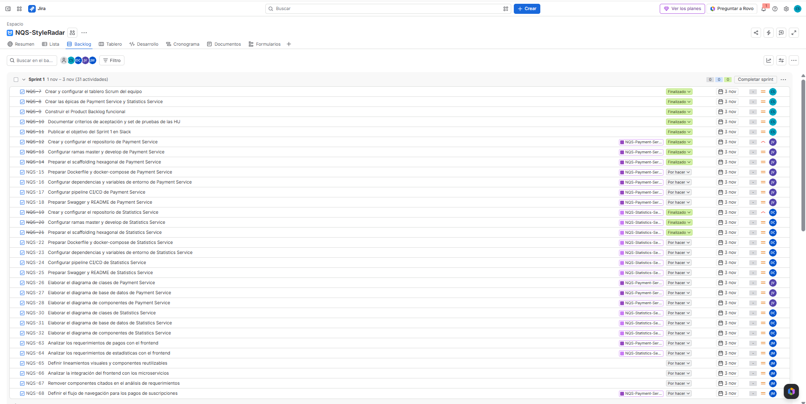

<!-- ==============================================================================
  STYLE RADAR 
  Asignatura: DOSW · 2026
  Estándar obligatorio unificado para los 13 microservicios del proyecto StyleRadar.

  INSTRUCCIONES DE USO:
  1. Reemplaza todos los campos entre <ángulos> o [corchetes] con los datos de tu microservicio.
  2. Mantén estrictamente el orden de las 12 secciones oficiales del curso.
  3. No agregues emojis para preservar la seriedad y el estándar de ingeniería.
  4. Los bloques <details> proporcionan interactividad nativa en GitHub / GitLab / Bitbucket.
============================================================================== -->

<!-- ==============================================================================
  STYLE RADAR · TIPOGRAFÍA Y SISTEMA DE DISEÑO OFICIAL
  Tipografía Oficial: Poppins (Manual de Identidad & Arquitectura Frontend)
  - Títulos Display (Black / Bold): Poppins 900 / 800 / 700
  - Subtítulos (SemiBold): Poppins 600
  - Cuerpo y Tablas (Regular): Poppins 400
  - Etiquetas y Badges (Medium): Poppins 500
  - Apoyo y Notas (Light): Poppins 300
  - Código y Terminal: JetBrains Mono
============================================================================== -->
<!-- ==============================================================================
  STYLE RADAR · RECURSOS 100% IMPORTADOS VÍA CDN / HTTPS (PORTABILIDAD TOTAL)
  Todos los logos, banners, fuentes y badges se importan desde la nube para que
  al copiar y pegar este README en cualquier repositorio nuevo se renderice
  a la perfección sin requerir archivos locales ni producir enlaces rotos.
============================================================================== -->

<div align="center">

  <a href="https://github.com/StyleRadar">
    
  </a>

  <h1>STYLE<font color="#5600EF">RADAR</font> &nbsp;·&nbsp; <code>ms-pagos-suscripciones</code></h1>

  <p align="center">
    
    
    
  </p>

  <p align="center">
    <strong><font color="#5600EF">Descubre tu estilo. En tu ciudad.</font></strong><br />
    <em>Plataforma de moda local con inventario multi-sede geolocalizado en tiempo real y probador virtual para Bogotá.</em>
  </p>

  <p align="center">
    <a href="https://styleradar-backend-prod.azurewebsites.net/swagger-ui/index.html">
      
    </a>
    <a href="https://styleradar-backend-qa.azurewebsites.net/swagger-ui/index.html">
      
    </a>
    <a href="<URL_SONARQUBE>">
      
    </a>
    <a href="target/site/jacoco/index.html">
      
    </a>
    <a href="#6-tecnologías-y-dependencias">
      
    </a>
    <a href="#6-tecnologías-y-dependencias">
      
    </a>
    <a href="#7-cómo-ejecutar-local-y-con-docker">
      
    </a>
  </p>

</div>


---

##  ÍNDICE DE CONTENIDOS

1. [Nombre del servicio y su bounded context](docs/secciones/01-nombre-del-servicio-y-bounded-context.md)
2. [Arquitectura hexagonal con sus diagramas](docs/secciones/02-arquitectura-hexagonal-y-diagramas.md)
3. [Endpoints y enlace a Swagger](docs/secciones/03-endpoints-y-enlace-a-swagger.md)
4. [Eventos que publica y consume](docs/secciones/04-eventos-que-publica-y-consume.md)
5. [Tecnologías y dependencias](docs/secciones/05-tecnologias-y-dependencias.md)
6. [Cómo ejecutar local y con Docker](docs/secciones/06-como-ejecutar-local-y-docker.md)
7. [Variables de entorno](docs/secciones/07-variables-de-entorno.md)
8. [Pruebas y cobertura (≥ 85%)](docs/secciones/08-pruebas-y-cobertura.md)
9. [CI/CD con el badge del pipeline](docs/secciones/09-cicd-pipeline.md)
10. [Ramas y cómo contribuir](docs/secciones/10-ramas-y-como-contribuir.md)
11. [Seguridad, Habeas Data y análisis OWASP Top 10](docs/secciones/11-seguridad-y-owasp.md)
12. [Equipo, responsables y enlace a la épica en Jira](docs/secciones/12-equipo-responsables-y-epica-jira.md)

---

<a id="11-ramas-y-cómo-contribuir"></a>

##  11. RAMAS Y CÓMO CONTRIBUIR

El equipo sigue el modelo de trabajo **GitFlow adaptado para microservicios**. La rama `main` se encuentra protegida y solo recibe cambios mediante Pull Requests aprobados.

### Estructura de Ramas Oficial

```text
main                    <-- Código en producción (Desplegado en Azure PROD)
└── develop             <-- Rama de integración continua (Staging / QA)
    ├── feature/SR-<ID>-<descripcion-corta>   <-- Nuevas funcionalidades
    ├── bugfix/SR-<ID>-<descripcion-corta>    <-- Corrección de defectos
    └── hotfix/<descripcion-corta>            <-- Parche urgente a main
```

### Convención de Commits (*Conventional Commits*)

Todo mensaje de commit debe seguir el estándar:

```text
<tipo>(<alcance>): <descripción imperativa en español> [#SR-RF-XX]

Ejemplos válidos:
feat(catalogo): agregar filtro de prendas por ocasión y estilo [#SR-RF-13]
fix(suscripcion): corregir inicio de suscripciones [#SR-RF-67]
test(dominio): agregar pruebas unitarias para entidad Prenda [#SR-RF-50]
docs(readme): actualizar variables de entorno y topología de eventos
```

### Checklist Obligatorio para Pull Requests

- [ ] La rama parte de la versión más reciente de `develop`.
- [ ] El código compila limpiamente con `mvn clean compile`.
- [ ] Todas las pruebas unitarias e integración pasan (`mvn verify`).
- [ ] La cobertura JaCoCo es mayor o igual al 85%.
- [ ] No se introducen credenciales, contraseñas ni tokens en el código fuente.
- [ ] El PR tiene asignado al menos 1 revisor del squad antes del merge.

---

<a id="12-enlace-a-la-épica-en-jira"></a>

##  12. ENLACE A LA ÉPICA EN JIRA

El seguimiento de requerimientos, evidencias y artefactos de entrega se centraliza en los siguientes enlaces oficiales:

### Enlaces de Gestión, Repositorios y Evidencias

* **Épica Oficial del Microservicio (Jira):** [https://mail-team-hdkr3g6f.atlassian.net/browse/NQS-5](https://mail-team-hdkr3g6f.atlassian.net/browse/NQS-5)
* **Tablero Scrum del Squad (Jira):** [https://mail-team-hdkr3g6f.atlassian.net/jira/software/projects/NQS/boards/1?filter=&groupBy=none](https://mail-team-hdkr3g6f.atlassian.net/jira/software/projects/NQS/boards/1?filter=&groupBy=none)

<div align="center">
  
</div>
