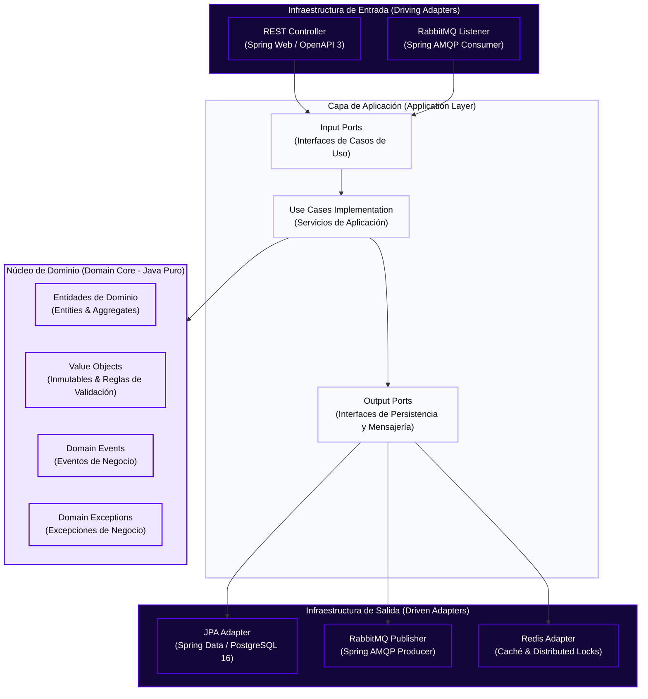
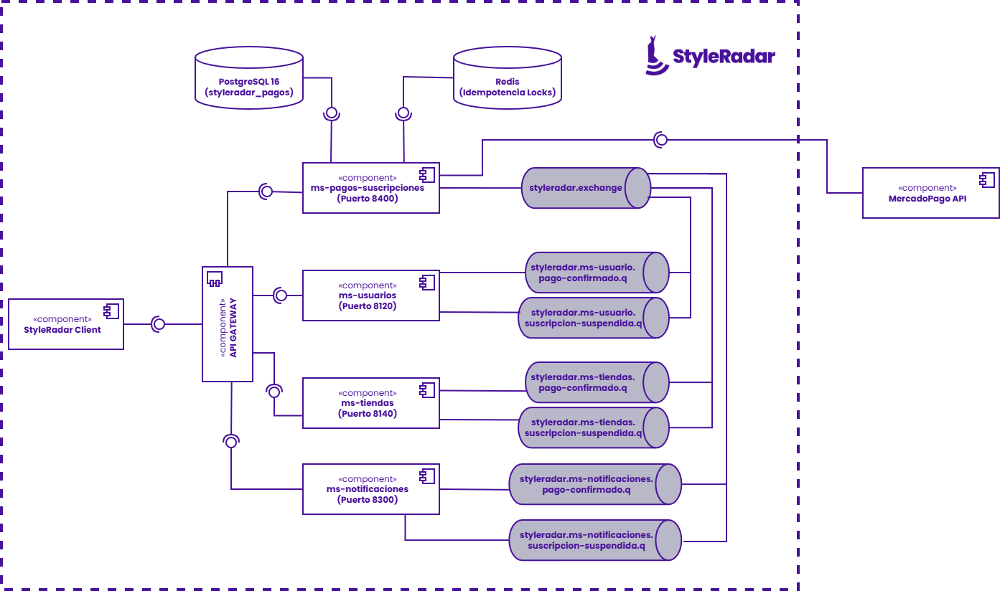
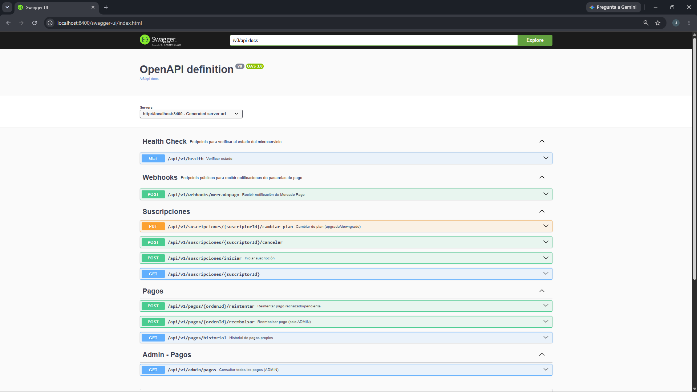
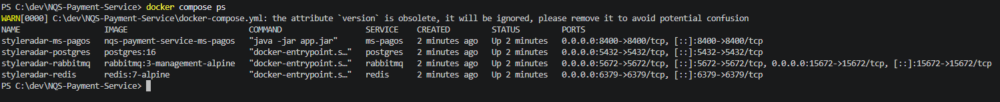
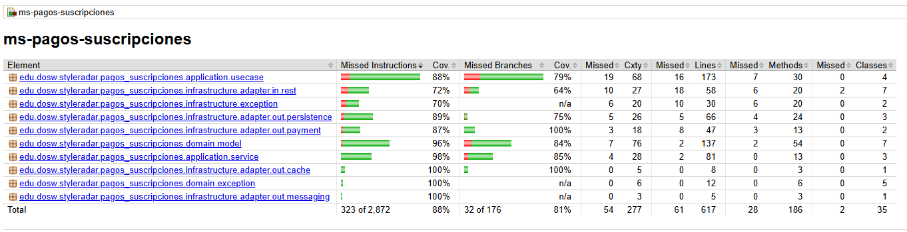
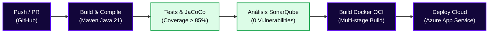
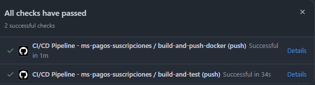
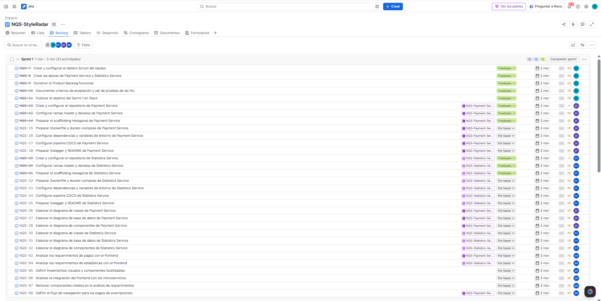

<!-- ==============================================================================
  STYLE RADAR 
  Asignatura: DOSW · 2026
  Estándar obligatorio unificado para los 13 microservicios del proyecto StyleRadar.

  INSTRUCCIONES DE USO:
  1. Reemplaza todos los campos entre <ángulos> o [corchetes] con los datos de tu microservicio.
  2. Mantén estrictamente el orden de las 12 secciones oficiales del curso.
  3. No agregues emojis para preservar la seriedad y el estándar de ingeniería.
  4. Los bloques <details> proporcionan interactividad nativa en GitHub / GitLab / Bitbucket.
============================================================================== -->

<!-- ==============================================================================
  STYLE RADAR · TIPOGRAFÍA Y SISTEMA DE DISEÑO OFICIAL
  Tipografía Oficial: Poppins (Manual de Identidad & Arquitectura Frontend)
  - Títulos Display (Black / Bold): Poppins 900 / 800 / 700
  - Subtítulos (SemiBold): Poppins 600
  - Cuerpo y Tablas (Regular): Poppins 400
  - Etiquetas y Badges (Medium): Poppins 500
  - Apoyo y Notas (Light): Poppins 300
  - Código y Terminal: JetBrains Mono
============================================================================== -->
<!-- ==============================================================================
  STYLE RADAR · RECURSOS 100% IMPORTADOS VÍA CDN / HTTPS (PORTABILIDAD TOTAL)
  Todos los logos, banners, fuentes y badges se importan desde la nube para que
  al copiar y pegar este README en cualquier repositorio nuevo se renderice
  a la perfección sin requerir archivos locales ni producir enlaces rotos.
============================================================================== -->

<div align="center">

  <a href="https://github.com/StyleRadar">
    
  </a>

  <h1>STYLE<font color="#5600EF">RADAR</font> &nbsp;·&nbsp; <code>ms-pagos-suscripciones</code></h1>

  <p align="center">
    
    
    
  </p>

  <p align="center">
    <strong><font color="#5600EF">Descubre tu estilo. En tu ciudad.</font></strong><br />
    <em>Plataforma de moda local con inventario multi-sede geolocalizado en tiempo real y probador virtual para Bogotá.</em>
  </p>

  <p align="center">
    <a href="https://styleradar-backend-prod.azurewebsites.net/swagger-ui/index.html">
      
    </a>
    <a href="https://styleradar-backend-qa.azurewebsites.net/swagger-ui/index.html">
      
    </a>
    <a href="<URL_SONARQUBE>">
      
    </a>
    <a href="target/site/jacoco/index.html">
      
    </a>
    <a href="#6-tecnologías-y-dependencias">
      
    </a>
    <a href="#6-tecnologías-y-dependencias">
      
    </a>
    <a href="#7-cómo-ejecutar-local-y-con-docker">
      
    </a>
  </p>

</div>


---

##  ÍNDICE DE CONTENIDOS

1. [Nombre del servicio y su bounded context](#1-nombre-del-servicio-y-su-bounded-context)
2. [Equipo y responsables](#2-equipo-y-responsables)
3. [Arquitectura hexagonal con su diagrama](#3-arquitectura-hexagonal-con-su-diagrama)
4. [Endpoints y enlace a Swagger](#4-endpoints-y-enlace-a-swagger)
5. [Eventos que publica y consume](#5-eventos-que-publica-y-consume)
6. [Tecnologías y dependencias](#6-tecnologías-y-dependencias)
7. [Cómo ejecutar local y con Docker](#7-cómo-ejecutar-local-y-con-docker)
8. [Variables de entorno](#8-variables-de-entorno)
9. [Pruebas y cobertura](#9-pruebas-y-cobertura)
10. [CI/CD con el badge del pipeline](#10-cicd-con-el-badge-del-pipeline)
11. [Ramas y cómo contribuir](#11-ramas-y-cómo-contribuir)
12. [Enlace a la épica en Jira](#12-enlace-a-la-épica-en-jira)

---

<a id="1-nombre-del-servicio-y-su-bounded-context"></a>

##  1. NOMBRE DEL SERVICIO Y SU BOUNDED CONTEXT

* **Identificador de Servicio:** `ms-pagos-suscripciones`
* **Paquete Arquitectónico:** `Paquete 4: Pagos y Estadisticas`
* **Puerto de Escucha Oficial:** `8400`
* **Base de Datos Asignada:** `PostgreSQL 16` (`styleradar_pagos`), aislada bajo el patrón *Database-per-Service*.
* **Bounded Context:** `Pagos de Suscripciones`

### Responsabilidades del Dominio

Este microservicio encapsula las responsabilidades relacionadas con la gestión de pagos asociados a las suscripciones de StyleRadar.

| Qué HACE este Microservicio (Alcance)                             | Qué NO HACE este Microservicio (Límites)                                          |
| :----------------------------------------------------------------- | :---------------------------------------------------------------------------------- |
| • Gestiona el proceso de pago de una suscripción, según los requerimientos definidos.                          | • NO autentica usuarios (delegado a `ms-auth` en `:8100`).                     |
| • Registra y consulta el estado de los pagos.                         | • No administra el catálogo de prendas ni el inventario de las tiendas.     |
| • Representa los resultados de pago, incluyendo los estados alternativos que definan los requerimientos.                       | • NO envía correos ni WebSockets (delegado a `ms-notificaciones` en `:8300`). |
| • Garantiza persistencia ACID e idempotencia en su base de datos. | • NO accede directamente a bases de datos de otros microservicios.                 |

### Arquetipos de Moda y Personajes de StyleRadar

<div align="center">

| Antonia (Sastre) | Mateo (Calle) | Aura (Futuro) | Nora (Rebelde) | Tomás (Esencial) |
| :---: | :---: | :---: | :---: | :---: |
| <br>**Sastre**<br><sub>Tiendas & Descubrimiento</sub> | <br>**Calle**<br><sub>Playlists & Cultura Urbana</sub> | <br>**Futuro**<br><sub>Probador Virtual AI</sub> | <br>**Rebelde**<br><sub>Segunda Vida & Vintage</sub> | <br>**Esencial**<br><sub>Fundaciones & Donaciones</sub> |

</div>

---

<a id="2-equipo-y-responsables"></a>

##  2. EQUIPO Y RESPONSABLES

Desarrollado y mantenido por el **Squad `NQS: No Queremos Scrum`** para la asignatura DOSW 2026.

<div align="center">

| Rol | Nombre Completo | Usuario GitHub |
| :---: | :---: | :---: |
| **Líder y apoyo** | `Cristian Camilo Ortiz Sanchez` | [@CatrachoINXS](https://github.com/CatrachoINXS) |
| **Backend Developer** | `Juan Manuel Garzón Viracacha` | [@JuanMaGV1](https://github.com/JuanMaGV1) |
| **Frontend Developer** | `Julian Felipe Morales Zambrano` | [@JulianMorales2003](https://github.com/JulianMorales2003) |

</div>

---

<a id="3-arquitectura-hexagonal-con-su-diagrama"></a>

##  3. ARQUITECTURA HEXAGONAL CON SU DIAGRAMA

El microservicio implementa **Arquitectura Hexagonal (Puertos y Adaptadores)** combinada con **Domain-Driven Design (DDD)**. El núcleo de negocio permanece 100% puro y aislado de frameworks, bases de datos o brokers de mensajería.

### Diagrama Interactivo de Capas (Mermaid)



<div align="center">
  
</div>

### Estructura Oficial de Paquetes en `src/main/java/`

```text
src/main/java/com/styleradar/pagos_suscripciones/
├── domain/                                  <-- NÚCLEO DE DOMINIO (Cero dependencias externas)
│   ├── model/                               <-- Entidades y Agregados raíz
│   ├── valueobject/                         <-- Value Objects inmutables (PrecioCop, Talla, UUIDv7)
│   ├── event/                               <-- Definición de Eventos de Dominio
│   └── exception/                           <-- Excepciones de reglas de negocio
├── application/                             <-- CAPA DE APLICACIÓN (Casos de Uso)
│   ├── port/
│   │   ├── in/                              <-- Input Ports (Interfaces para controladores)
│   │   └── out/                             <-- Output Ports (Interfaces para repositorios y broker)
│   ├── usecase/                             <-- Implementación de casos de uso
│   └── dto/                                 <-- DTOs de entrada y salida (Java Records)
└── infrastructure/                          <-- CAPA DE INFRAESTRUCTURA (Adaptadores)
    ├── adapter/
    │   ├── in/
    │   │   ├── rest/                        <-- Spring REST Controllers y OpenAPI Spec
    │   │   └── amqp/                        <-- Consumidores de eventos RabbitMQ
    │   └── out/
    │       ├── persistence/                 <-- Spring Data JPA Repositories y Entidades SQL
    │       ├── messaging/                   <-- Productores RabbitMQ (AmqpTemplate)
    │       └── cache/                       <-- Clientes Redis (RedisTemplate / Redlock)
    └── config/                              <-- Beans de configuración Spring (Seguridad, AMQP, DB)
```

---

<a id="4-endpoints-y-enlace-a-swagger"></a>

##  4. ENDPOINTS Y ENLACE A SWAGGER

La documentación interactiva OpenAPI 3.0 y los contratos de ejecución se encuentran desplegados y clasificados por entorno:

### Matriz Oficial de Enlaces por Entorno (PROD, QA, LOCAL)

| Entorno | Estado | Propósito | URL Base del Servicio | Swagger OpenAPI UI | Health Check |
| :--- | :---: | :--- | :--- | :--- | :--- |
| **Producción (PROD)** | Active | Despliegue productivo de StyleRadar | `  https://ms-pagos-prod.happyriver-65727909.northcentralus.azurecontainerapps.io` | [Swagger UI PROD](  https://ms-pagos-prod.happyriver-65727909.northcentralus.azurecontainerapps.io/swagger-ui/index.html) | [`/actuator/health`](https://ms-pagos-prod.happyriver-65727909.northcentralus.azurecontainerapps.io/actuator/health) |
| **Calidad / Pruebas (QA)** | Active | Pruebas integradas de Sprint y QA | `https://ms-pagos-qa.happyriver-65727909.northcentralus.azurecontainerapps.io` | [Swagger UI QA](https://ms-pagos-qa.happyriver-65727909.northcentralus.azurecontainerapps.io/swagger-ui/index.html) | [`/actuator/health`](https://ms-pagos-qa.happyriver-65727909.northcentralus.azurecontainerapps.io/actuator/health) |
| **Desarrollo Local (DEV)** | Local | Entorno de desarrollo local en máquina | `http://localhost:8400` | [Swagger UI Local](http://localhost:8400/swagger-ui.html) | [`/actuator/health`](http://localhost:8400/actuator/health) |

* **Especificación OpenAPI (Contrato JSON Schema):** `http://localhost:8400/v3/api-docs` (o `/v3/api-docs` en los dominios de PROD y QA).


<div align="center">
  

</div>

### Tabla de Endpoints Expuestos

|  Método  | Endpoint                            | Descripción                                      | Rol Requerido         |      Códigos HTTP      | 
| :--------: | :---------------------------- | :----------------------------------------- | :-------------------- | :-----------------------: |
|  `POST`  | `/api/v1/suscripciones/iniciar` | Crea una suscripción en estado PENDIENTE, genera una orden y retorna el link de pago. | Público (Vía Gateway) |          `201`, `400`, `500`          |
|  `GET`  | `/api/v1/suscripciones/{suscriptorId}` | Consulta los detalles y estado actual de la suscripción de un usuario/almacén. | Público (Vía Gateway) |          `200`, `404`          |
|  `POST`  | `/api/v1/suscripciones/{suscriptorId}/cancelar` | Cancela la auto-renovación en MP. Mantiene activo el tiempo ya pagado. | Público (Vía Gateway) |          `200`, `404`          |
|  `PUT`  | `/api/v1/suscripciones/{suscriptorId}/cambiar-plan` | Cambia de plan. Si es Upgrade, retorna link de pago por la diferencia. Si es Downgrade, lo programa. | Público (Vía Gateway) |          `200`, `400`          |
|  `GET`  | `/api/v1/pagos/historial` | Consulta el historial de pagos propios del usuario autenticado. | JWT / Header X-User-Id |          `200`, `401`          |
|  `POST`  | `/api/v1/pagos/{ordenId}/reembolsar` | Solicita reembolso total o parcial de un pago aprobado. | Requiere rol ADMIN (JWT) |          `200`, `400`, `403`          |
|  `POST`  | `/api/v1/pagos/{ordenId}/reintentar` | Reintenta un pago rechazado/pendiente generando una nueva orden. | JWT / Header X-User-Id |          `200`, `400`          |
|  `GET`  | `/api/v1/admin/pagos` | Consulta global de todos los pagos de la plataforma, filtrable por estado. | Requiere rol ADMIN (JWT) |          `200`, `403`          |
|  `POST`  | `/api/v1/webhooks/mercadopago` | Recibe notificaciones de MP, valida HMAC, actualiza BD y publica evento. | Público + HMAC (x-signature) |          `200`, `400`          |
|  `GET`  | `/api/v1/health` | Verifica el estado del microservicio (Actuator / Custom). | Público |          `200`          |

<details>
<summary><b>Click para ver Ejemplo Interactivo de Request y Response JSON (Payloads)</b></summary>

<br>

#### Ejemplo Request (`POST /api/v1/suscripciones/iniciar`)

```bash
curl -X POST \
  "http://localhost:8400/api/v1/suscripciones/iniciar" \
  -H "accept: text/plain" \
  -H "Content-Type: application/json" \
  -d '{
    "suscriptorId": "USER-TEST-FINAL",
    "planId": 2,
    "tipoSuscriptor": "USUARIO"
    "emailPayer": "test_user_117646358391238183361@testuser.com"
}'
```

#### Ejemplo Response Exitoso (`200 OK`)

```json
https://www.mercadopago.com.co/subscriptions/checkout?preapproval_id=c388e668fbc87474b129d889e98732888activation=true
```
#### Response exitoso (`PUT /api/v1/suscripciones/{suscriptorId}/cambiar-plan`)
 
```json
{
  "tipo": "UPGRADE",
  "init_point": "https://www.mercadopago.com.co/...",
  "mensaje": "Pague la diferencia para activar el nuevo plan inmediatamente."
}
```
 
#### Response exitoso (`GET /api/v1/admin/pagos`)
 
Array directo (actualmente **no paginado**):
 
```json
[
  {
    "id": 1,
    "suscripcionId": 100,
    "monto": { "valor": 14900.00, "moneda": "COP" },
    "estado": "APROBADO",
    "idPagoExterno": "MP-12345",
    "montoReembolsado": { "valor": 0.00, "moneda": "COP" },
    "motivoReembolso": null,
    "fechaCreacion": "2026-11-11T10:00:00"
  }
]
```
 
#### Response de Error (`GlobalExceptionHandler`)
 
Aplica para cualquier `400`, `403`, `404`, `409` y `500`:
 
```json
{
  "timestamp": "2026-11-11T22:15:30.123",
  "status": 400,
  "error": "INVALID_STATE",
  "message": "La suscripción ya está activa. No se requiere reintentar el pago.",
  "path": "/api/v1/pagos/1/reintentar"
}
```
</details>

---

<a id="5-eventos-que-publica-y-consume"></a>

##  5. EVENTOS QUE PUBLICA Y CONSUME

La comunicación asíncrona entre microservicios se orquesta a través de **RabbitMQ 3.12**. Este microservicio actúa como **productor** del evento de confirmación de pago.
 
* **Exchange de Pagos:** `styleradar.payments.exchange`
* **Rol actual:** Productor. No consume eventos de otros microservicios.
### Matriz de Eventos AMQP
 
|       Tipo       | Routing Key / Evento | Exchange                       | Microservicio Emisor / Receptor | Cuándo se Dispara / Acción |
| :---------------: | :------------------- | :----------------------------- | :------------------------------ | :-------------------------- |
| **PUBLICA** | `pago.confirmado`    | `styleradar.payments.exchange` | `ms-pagos-suscripciones`        | Se publica tras recibir el webhook de Mercado Pago, validar la firma HMAC, garantizar idempotencia (Redis SETNX) y actualizar la BD. |
| **CONSUME** | N/A                  | N/A                            | N/A                             | Actualmente no consume eventos ni consulta a otros microservicios para funcionar. |
 
### Consumidores del Evento `pago.confirmado`
 
| Microservicio Consumidor | Acción esperada |
| :--- | :--- |
| `ms-usuarios` | Aplica los beneficios del plan (por ejemplo, límites de wishlist). |
| `ms-tiendas` (o `ms-identidad`) | Aplica los beneficios del plan (por ejemplo, límites de catálogo). |
 
<details>
<summary><b>Click para ver Esquema JSON del Evento Publicado (con Idempotencia)</b></summary>
<br>
> Esquema ilustrativo del sobre del evento. Los campos de `data` deben validarse contra la clase real del evento en el código.
 
```json
{
  "eventId": "018e3a2b-3333-7000-8000-000000000003",
  "eventType": "pago.confirmado",
  "timestamp": "2026-11-11T14:30:00Z",
  "producer": "ms-pagos-suscripciones",
  "correlationId": "corr-uuid-9999",
  "data": {
    "ordenId": 1,
    "suscriptorId": "USER-123",
    "tipoSuscriptor": "USUARIO",
    "planId": 2,
    "estado": "APROBADO"
  }
}
```
 
</details>


---

<a id="6-tecnologías-y-dependencias"></a>

##  6. TECNOLOGÍAS Y DEPENDENCIAS

El stack del microservicio cumple con el estándar unificado de arquitectura de StyleRadar:

| Capa / Componente                | Tecnología       | Versión   | Justificación Técnica                                                                        |
| :------------------------------- | :---------------- | :--------- | :--------------------------------------------------------------------------------------------- |
| **Lenguaje Core**          | Java LTS          | `21`     | Virtual Threads (Project Loom) para concurrencia masiva I/O sin saturar hilos del OS.          |
| **Framework Empresarial**  | Spring Boot       | `3.2.5`  | Gestión declarativa de configuración, ecosistema nativo Spring Data y Spring AMQP.           |
| **Base de Datos**          | PostgreSQL        | `16`     | Integridad transaccional ACID. Tablas: `planes`, `suscripciones`, `ordenes_pago`, `webhooks_log`. |
| **Migraciones de BD**      | Flyway            | `10.10.0`   | Control de versiones reproducible de scripts SQL en arranque; valida el esquema real.           |
| **Broker de Mensajería**  | RabbitMQ          | `3.12+`  | Publicación del evento `pago.confirmado` en `styleradar.payments.exchange`.                    |
| **Caché en Memoria**      | Redis             | `7.x`    | Bloqueo `SETNX` para idempotencia en el procesamiento de webhooks de Mercado Pago.           |
| **Cliente HTTP Declarativo** | Spring Cloud OpenFeign | `2023.0.1` | Consumo de las APIs de Mercado Pago (Preapproval para suscripciones y Payments para reembolsos). |
| **Testing Core**           | JUnit 5 + Mockito | `5.10.x` | Pruebas unitarias sobre el núcleo de dominio sin inicializar el contenedor Spring.            |
| **Testing Integración**   | Testcontainers    | `1.19.7` | Instanciación automática de PostgreSQL y RabbitMQ en Docker durante `mvn verify`.          |
| **Métricas de Cobertura** | JaCoCo Plugin     | `0.8.11` | Verificación estricta de cobertura mínima (≥ 85%) como regla de fallo en el build.     |

---

<a id="7-cómo-ejecutar-local-y-con-docker"></a>

##  7. CÓMO EJECUTAR LOCAL Y CON DOCKER

### Prerrequisitos de Entorno

* **Java Development Kit (JDK):** Versión 21 LTS instalada (`java -version`).
* **Apache Maven:** Versión 3.9+ instalada (`mvn -version`).
* **Docker Engine & Docker Compose:** Versión 24+ en ejecución (`docker --version`).

### Ejecución Local con Maven (Perfil Dev)

```bash
# 1. Clonar el repositorio
git clone https://github.com/StyleRadar/NQS-Payment-Service.git
cd NQS-Payment-Service

# 2. Levantar servicios de infraestructura en Docker (PostgreSQL, Redis, RabbitMQ)
docker compose up -d postgres rabbitmq redis

# 3. Ejecutar el microservicio localmente
mvn clean spring-boot:run -Dspring-boot.run.profiles=dev
```

### Comprobación de Salud (Health Check)

```bash
curl -s http://localhost:8400/actuator/health | jq .
# Esperado: {"status":"UP","components":{"db":{"status":"UP"},"rabbit":{"status":"UP"}}}
```

<div align="center">


          
</div>


---

<a id="8-variables-de-entorno"></a>

##  8. VARIABLES DE ENTORNO

Todas las configuraciones sensibles y dependientes de entorno se externalizan mediante variables de sistema conformes al estándar **Twelve-Factor App**.

| Variable                   | Descripción                                 | Valor por Defecto (`dev`) | Requerido en Prod |
| :------------------------- | :------------------------------------------- | :-------------------------- | :---------------: |
| `SERVER_PORT`            | Puerto de escucha HTTP del microservicio     | `8400`                    |        Sí        |
| `SPRING_PROFILES_ACTIVE` | Perfil de configuración Spring Boot activo  | `dev`                     |        Sí        |
| `DB_HOST`                | Hostname o IP del servidor PostgreSQL        | `localhost`               |        Sí        |
| `DB_PORT`                | Puerto de conexión a PostgreSQL             | `5432`                    |        Sí        |
| `DB_NAME`                | Nombre de la base de datos aislada           | `suscripciones_pagos`          |        Sí        |
| `DB_USER`                | Usuario de conexión a la base de datos      | `styleradar_user`         |        Sí        |
| `DB_PASSWORD`            | Contraseña del usuario de base de datos     | `secret_dev_pass`         |        Sí        |
| `RABBITMQ_HOST`          | Hostname del broker de mensajería           | `localhost`               |        Sí        |
| `RABBITMQ_PORT`          | Puerto AMQP de RabbitMQ                      | `5672`                    |        Sí        |
| `RABBITMQ_USERNAME`      | Usuario de conexión a RabbitMQ              | `guest`                   |        Sí        |
| `RABBITMQ_PASSWORD`      | Contraseña de conexión a RabbitMQ          | `guest`                   |        Sí        |
| `REDIS_HOST`             | Hostname del servidor Redis (idempotencia de webhooks) | `localhost`        |        Sí        |
| `REDIS_PORT`             | Puerto de conexión a Redis                   | `6379`                    |        Sí        |
| `MP_ACCESS_TOKEN`        | Access Token de Mercado Pago (sandbox en dev) | `<MP_SANDBOX_TOKEN>`      |        Sí        |
| `MP_PUBLIC_KEY`          | Inicializar la integracion de pagos y proteger la informacion enviada | `<MP_PUBLIC_KEY>`      |        Sí        |
| `MP_WEBHOOK_SECRET`      | Secreto para validar la firma HMAC (`x-signature`) del webhook | `<MP_WEBHOOK_SECRET>` |        Sí        |
| `JWT_PUBLIC_KEY`         | Clave pública RSA/RS256 para validar tokens | `<PATH_OR_PEM_VALUE>`     |        Sí        |

<details>
<summary><b>Click para copiar la Plantilla de Archivo .env.example</b></summary>

<br>

```dotenv
# ==============================================================================
# STYLERADAR · VARIABLES DE ENTORNO LOCALES (.env)
# ==============================================================================
SERVER_PORT=8400
SPRING_PROFILES_ACTIVE=dev

# Persistencia PostgreSQL
DB_HOST=localhost
DB_PORT=5432
DB_NAME=styleradar_pagos
DB_USER=styleradar_user
DB_PASSWORD=styleradar_secret

# Event Broker RabbitMQ
RABBITMQ_HOST=localhost
RABBITMQ_PORT=5672
RABBITMQ_USERNAME=guest
RABBITMQ_PASSWORD=guest

# Caché Redis (idempotencia de webhooks)
REDIS_HOST=localhost
REDIS_PORT=6379
 
# Mercado Pago
MP_ACCESS_TOKEN=<MP_SANDBOX_TOKEN>
MP_WEBHOOK_SECRET=<MP_WEBHOOK_SECRET>
 
# Seguridad JWT
JWT_PUBLIC_KEY=classpath:keys/public-key.pem
```

</details>

---

<a id="9-pruebas-y-cobertura"></a>

##  9. PRUEBAS Y COBERTURA (≥ 85%)

El proyecto exige una cobertura de código mínima del **85%** verificada automáticamente mediante el plugin de **JaCoCo** durante la fase de compilación.

### Comandos de Ejecución de Pruebas

```bash
# Ejecutar todas las pruebas unitarias y de integración
mvn clean verify

# Generar únicamente el reporte HTML de JaCoCo
mvn jacoco:report
```

* **Ruta del Reporte HTML:** `target/site/jacoco/index.html`

<div align="center">
  
</div>


### Pirámide de Pruebas Implementada

| Nivel de Prueba                   | Alcance                                    | Tecnologías Utilizadas          | Ubicación en el Código                                    | Cobertura Meta |
| :-------------------------------- | :----------------------------------------- | :------------------------------- | :---------------------------------------------------------- | :------------: |
| **Pruebas Unitarias**       | Lógica de Dominio y Casos de Uso aislados | JUnit 5, Mockito, AssertJ        | `src/test/java/edu/dosw/styleradar/pagos_suscripciones/application/`, | ≥ 85% |
| **Pruebas de Integración** | Repositorios JPA y Adaptadores REST        | Spring Boot Test, Testcontainers | `src/test/java/edu/dosw/styleradar/pagos_suscripciones/infrastructure/`                       |  ≥ 85%  |
| **Pruebas de Contrato**     | Verificación de contratos OpenAPI         | MockMvc, JSON Assert             | `src/test/java/edu/dosw/styleradar/pagos_suscripciones/infrastructure/adapter/in/rest/`                                 |  ≥ 85%  |

> [!IMPORTANT]
> **Criterio de Fallo en CI:** El archivo `pom.xml` contiene la regla `<limit><minimum>0.85</minimum></limit>`. Si la cobertura total consolidada es inferior al 85%, el comando `mvn verify` fallará con error y el pipeline bloqueará el Pull Request.

---

<a id="10-cicd-con-el-badge-del-pipeline"></a>

##  10. CI/CD CON EL BADGE DEL PIPELINE

El ciclo de vida del software implementa integración continua y entrega continua automatizada mediante **GitHub Actions / Azure Pipelines**:

### Matriz de Pipelines por Entorno (PROD y QA)

| Pipeline | Entorno Destino | Desencadenador (Trigger) | Quality Gate Exigido | Badge de Estado |
| :--- | :--- | :--- | :--- | :---: |
| **CI - Staging / QA** | Calidad (`QA`) | Pull Request o Push a rama `develop` | Build OK + Tests Unitarios/Integración + JaCoCo ≥ 85% + SonarQube OK | [](https://github.com/CatrachoINXS/StyleRadar-Backend/actions) |
| **CD - Producción (PROD)** | Producción (`PROD`) | Merge a rama `main` tras validación QA | Aprobación manual + Imagen OCI desplegada en Azure App Service | [](https://github.com/CatrachoINXS/StyleRadar-Backend/actions) |
| **Quality Gate SonarQube** | Transversal | Ejecutado en cada build de CI | 0 Vulnerabilidades, 0 Bugs, Deuda Técnica &lt; 5% | [](<URL_SONARQUBE>) |

### Diagrama del Flujo Automatizado (Pipeline Stages)



### Reglas de Calidad en SonarQube (*Quality Gate Passed*)

* **Bugs:** 0
* **Vulnerabilidades:** 0
* **Hotspots de Seguridad:** 0 revisados al 100%
* **Code Smells Críticos:** 0
* **Deuda Técnica:** < 5%

<div align="center">
  
</div>

---

<a id="11-ramas-y-cómo-contribuir"></a>

##  11. RAMAS Y CÓMO CONTRIBUIR

El equipo sigue el modelo de trabajo **GitFlow adaptado para microservicios**. La rama `main` se encuentra protegida y solo recibe cambios mediante Pull Requests aprobados.

### Estructura de Ramas Oficial

```text
main                    <-- Código en producción (Desplegado en Azure PROD)
└── develop             <-- Rama de integración continua (Staging / QA)
    ├── feature/SR-<ID>-<descripcion-corta>   <-- Nuevas funcionalidades
    ├── bugfix/SR-<ID>-<descripcion-corta>    <-- Corrección de defectos
    └── hotfix/<descripcion-corta>            <-- Parche urgente a main
```

### Convención de Commits (*Conventional Commits*)

Todo mensaje de commit debe seguir el estándar:

```text
<tipo>(<alcance>): <descripción imperativa en español> [#SR-RF-XX]

Ejemplos válidos:
feat(catalogo): agregar filtro de prendas por ocasión y estilo [#SR-RF-13]
fix(suscripcion): corregir inicio de suscripciones [#SR-RF-67]
test(dominio): agregar pruebas unitarias para entidad Prenda [#SR-RF-50]
docs(readme): actualizar variables de entorno y topología de eventos
```

### Checklist Obligatorio para Pull Requests

- [ ] La rama parte de la versión más reciente de `develop`.
- [ ] El código compila limpiamente con `mvn clean compile`.
- [ ] Todas las pruebas unitarias e integración pasan (`mvn verify`).
- [ ] La cobertura JaCoCo es mayor o igual al 85%.
- [ ] No se introducen credenciales, contraseñas ni tokens en el código fuente.
- [ ] El PR tiene asignado al menos 1 revisor del squad antes del merge.

---

<a id="12-enlace-a-la-épica-en-jira"></a>

##  12. ENLACE A LA ÉPICA EN JIRA

El seguimiento de requerimientos, evidencias y artefactos de entrega se centraliza en los siguientes enlaces oficiales:

### Enlaces de Gestión, Repositorios y Evidencias

* **Épica Oficial del Microservicio (Jira):** [https://mail-team-hdkr3g6f.atlassian.net/browse/NQS-5](https://mail-team-hdkr3g6f.atlassian.net/browse/NQS-5)
* **Tablero Scrum del Squad (Jira):** [https://mail-team-hdkr3g6f.atlassian.net/jira/software/projects/NQS/boards/1?filter=&groupBy=none](https://mail-team-hdkr3g6f.atlassian.net/jira/software/projects/NQS/boards/1?filter=&groupBy=none)

<div align="center">
  
</div>

### Requerimientos Funcionales Asignados

| Código RF | Nombre del Requerimiento | Historia en Jira |
|---|---|---|
| `SR-RF-67` | Suscribir almacén aliado | `NQS-33` |
| `SR-RF-68` | Cancelar suscripción de almacén | `NQS-34` |
| `SR-RF-75` | Consultar pagos de suscripciones | `NQS-35` |
| `SR-RF-93` | Pagar suscripción mediante pasarela de pagos | `NQS-52` |
| `SR-RF-94` | Confirmar el estado del pago | `NQS-53` |
| `SR-RF-95` | Renovar suscripción con cobro automático | `NQS-54` |
| `SR-RF-96` | Reintentar pago rechazado | `NQS-55` |
| `SR-RF-97` | Consultar historial de pagos propios | `NQS-56` |
| `SR-RF-98` | Reembolsar pago de suscripción | `NQS-57` |
| `SR-RF-99` | Suspender catálogo por falta de pago | `NQS-58` |
| `SR-RF-100` | Suscribirse a un plan de usuario | `NQS-59` |
| `SR-RF-101` | Cambiar o cancelar plan de usuario | `NQS-60` |
| `SR-RF-102` | Aplicar beneficios según el plan del usuario | `NQS-61` |
| `SR-RF-103` | Volver al plan gratuito por falta de pago | `NQS-62` |