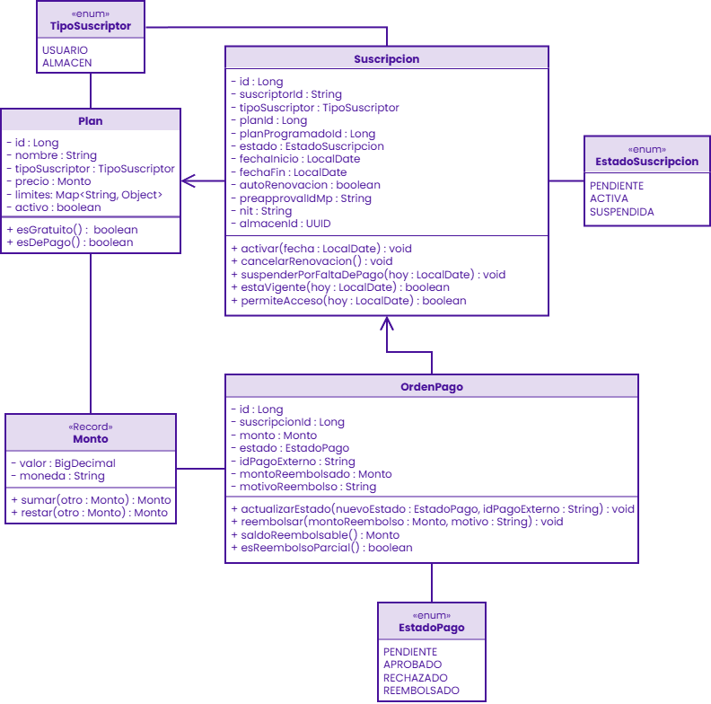
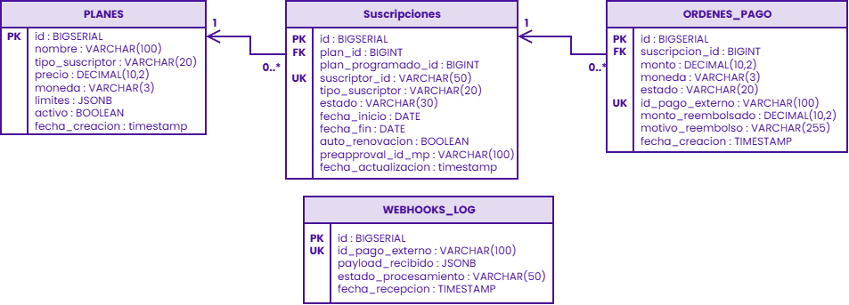
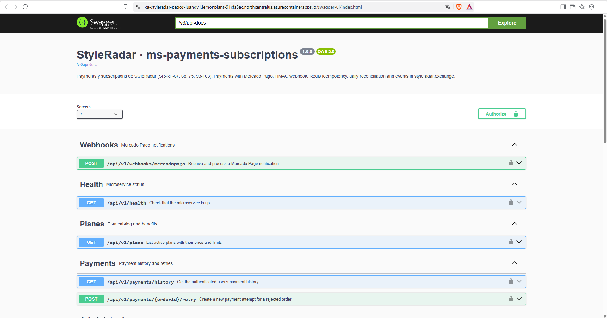
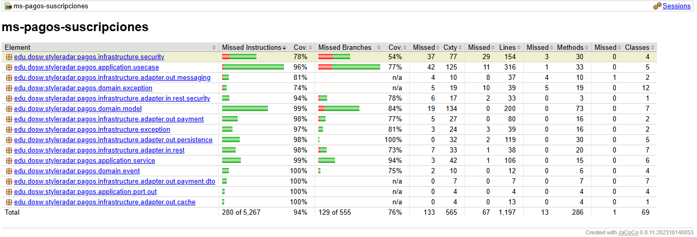
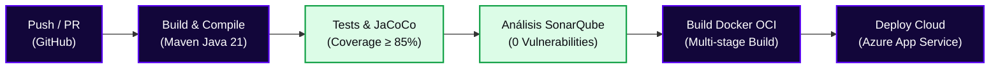
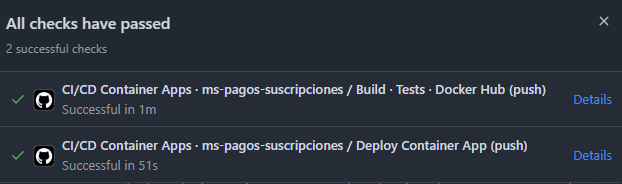

<!-- ==============================================================================
  STYLE RADAR 
  Asignatura: DOSW · 2026
  Estándar obligatorio unificado para los 13 microservicios del proyecto StyleRadar.

  INSTRUCCIONES DE USO:
  1. Reemplaza todos los campos entre <ángulos> o [corchetes] con los datos de tu microservicio.
  2. Mantén estrictamente el orden de las 12 secciones oficiales del curso.
  3. No agregues emojis para preservar la seriedad y el estándar de ingeniería.
  4. Los bloques <details> proporcionan interactividad nativa en GitHub / GitLab / Bitbucket.
============================================================================== -->

<!-- ==============================================================================
  STYLE RADAR · TIPOGRAFÍA Y SISTEMA DE DISEÑO OFICIAL
  Tipografía Oficial: Poppins (Manual de Identidad & Arquitectura Frontend)
  - Títulos Display (Black / Bold): Poppins 900 / 800 / 700
  - Subtítulos (SemiBold): Poppins 600
  - Cuerpo y Tablas (Regular): Poppins 400
  - Etiquetas y Badges (Medium): Poppins 500
  - Apoyo y Notas (Light): Poppins 300
  - Código y Terminal: JetBrains Mono
============================================================================== -->
<!-- ==============================================================================
  STYLE RADAR · RECURSOS 100% IMPORTADOS VÍA CDN / HTTPS (PORTABILIDAD TOTAL)
  Todos los logos, banners, fuentes y badges se importan desde la nube para que
  al copiar y pegar este README en cualquier repositorio nuevo se renderice
  a la perfección sin requerir archivos locales ni producir enlaces rotos.
============================================================================== -->

<div align="center">

  <a href="https://github.com/StyleRadar">
    
  </a>

  <h1>STYLE<font color="#5600EF">RADAR</font> &nbsp;·&nbsp; <code>ms-pagos-suscripciones</code></h1>

  <p align="center">
    
    
    
  </p>

  <p align="center">
    <strong><font color="#5600EF">Descubre tu estilo. En tu ciudad.</font></strong><br />
    <em>Plataforma de moda local con inventario multi-sede geolocalizado en tiempo real y probador virtual para Bogotá.</em>
  </p>

  <p align="center">
    <a href="https://styleradar-backend-prod.azurewebsites.net/swagger-ui/index.html">
      
    </a>
    <a href="https://styleradar-backend-qa.azurewebsites.net/swagger-ui/index.html">
      
    </a>
    <a href="<URL_SONARQUBE>">
      
    </a>
    <a href="target/site/jacoco/index.html">
      
    </a>
    <a href="#6-tecnologías-y-dependencias">
      
    </a>
    <a href="#6-tecnologías-y-dependencias">
      
    </a>
    <a href="#7-cómo-ejecutar-local-y-con-docker">
      
    </a>
  </p>

</div>


---

##  ÍNDICE DE CONTENIDOS

1. [Nombre del servicio y su bounded context](#1-nombre-del-servicio-y-su-bounded-context)
2. [Equipo y responsables](#2-equipo-y-responsables)
3. [Arquitectura hexagonal con su diagrama](#3-arquitectura-hexagonal-con-su-diagrama)
4. [Endpoints y enlace a Swagger](#4-endpoints-y-enlace-a-swagger)
5. [Eventos que publica y consume](#5-eventos-que-publica-y-consume)
6. [Tecnologías y dependencias](#6-tecnologías-y-dependencias)
7. [Cómo ejecutar local y con Docker](#7-cómo-ejecutar-local-y-con-docker)
8. [Variables de entorno](#8-variables-de-entorno)
9. [Pruebas y cobertura](#9-pruebas-y-cobertura)
10. [CI/CD con el badge del pipeline](#10-cicd-con-el-badge-del-pipeline)
11. [Ramas y cómo contribuir](#11-ramas-y-cómo-contribuir)
12. [Enlace a la épica en Jira](#12-enlace-a-la-épica-en-jira)

---

<a id="1-nombre-del-servicio-y-su-bounded-context"></a>

##  1. NOMBRE DEL SERVICIO Y SU BOUNDED CONTEXT

* **Identificador de Servicio:** `ms-pagos-suscripciones`
* **Paquete Arquitectónico:** `Paquete 4: Pagos y Estadisticas`
* **Puerto de Escucha Oficial:** `8400`
* **Base de Datos Asignada:** `PostgreSQL 16` (`styleradar_pagos`), aislada bajo el patrón *Database-per-Service*.
* **Bounded Context:** `Pagos de Suscripciones`

### Responsabilidades del Dominio

Este microservicio encapsula las responsabilidades relacionadas con la gestión de pagos asociados a las suscripciones de StyleRadar.

| Qué HACE este Microservicio (Alcance)                             | Qué NO HACE este Microservicio (Límites)                                          |
| :----------------------------------------------------------------- | :---------------------------------------------------------------------------------- |
| • Gestiona el proceso de pago de una suscripción, según los requerimientos definidos.                          | • NO autentica usuarios (delegado a `ms-auth` en `:8100`).                     |
| • Registra y consulta el estado de los pagos.                         | • No administra el catálogo de prendas ni el inventario de las tiendas.     |
| • Representa los resultados de pago, incluyendo los estados alternativos que definan los requerimientos.                       | • NO envía correos ni WebSockets (delegado a `ms-notificaciones` en `:8300`). |
| • Garantiza persistencia ACID e idempotencia en su base de datos. | • NO accede directamente a bases de datos de otros microservicios.                 |

### Arquetipos de Moda y Personajes de StyleRadar

<div align="center">

| Antonia (Sastre) | Mateo (Calle) | Aura (Futuro) | Nora (Rebelde) | Tomás (Esencial) |
| :---: | :---: | :---: | :---: | :---: |
| <br>**Sastre**<br><sub>Tiendas & Descubrimiento</sub> | <br>**Calle**<br><sub>Playlists & Cultura Urbana</sub> | <br>**Futuro**<br><sub>Probador Virtual AI</sub> | <br>**Rebelde**<br><sub>Segunda Vida & Vintage</sub> | <br>**Esencial**<br><sub>Fundaciones & Donaciones</sub> |

</div>

---

<a id="2-equipo-y-responsables"></a>

##  2. EQUIPO Y RESPONSABLES

Desarrollado y mantenido por el **Squad `NQS: No Queremos Scrum`** para la asignatura DOSW 2026.

<div align="center">

| Rol | Nombre Completo | Usuario GitHub |
| :---: | :---: | :---: |
| **Líder y apoyo** | `Cristian Camilo Ortiz Sanchez` | [@CatrachoINXS](https://github.com/CatrachoINXS) |
| **Backend Developer** | `Juan Manuel Garzón Viracacha` | [@JuanMaGV1](https://github.com/JuanMaGV1) |
| **Frontend Developer** | `Julian Felipe Morales Zambrano` | [@JulianMorales2003](https://github.com/JulianMorales2003) |

</div>

---

<a id="3-arquitectura-hexagonal-con-su-diagrama"></a>

##  3. ARQUITECTURA HEXAGONAL CON SU DIAGRAMA

El microservicio implementa **Arquitectura Hexagonal (Puertos y Adaptadores)** combinada con **Domain-Driven Design (DDD)**. El núcleo de negocio permanece 100% puro y aislado de frameworks, bases de datos o brokers de mensajería.

## 3.1 Diagrama de CLases



## 3.2 Diagrama Entidad-Relación de Base de Datos (PostgreSQL 16)



Reglas e índices relevantes:

- `planes.tipo_suscriptor` ∈ `USUARIO`/`ALMACEN`; `precio >= 0`.
- `suscripciones.estado` ∈ `PENDIENTE`/`ACTIVA`/`SUSPENDIDA`.
- Índice único parcial `uq_suscripcion_activa_pendiente`: un suscriptor no puede tener dos suscripciones `ACTIVA` o `PENDIENTE` simultáneas.
- `ordenes_pago.estado` ∈ `PENDIENTE`/`APROBADO`/`RECHAZADO`/`REEMBOLSADO`; `monto_reembolsado <= monto`.
- `ordenes_pago.id_pago_externo` y `webhooks_log.id_pago_externo` son únicos: segunda barrera de idempotencia.


### Estructura Oficial de Paquetes en `src/main/java/`

```text
domain/        Java puro: Plan, Suscripcion, OrdenPago, Monto, enums, eventos y excepciones
application/   puertos in/out, DTOs, casos de uso, schedulers y servicios de aplicación
infrastructure/adapter/in/rest      controladores REST, webhook, health
infrastructure/adapter/out/persistence  JPA + PostgreSQL/Flyway
infrastructure/adapter/out/payment      Mercado Pago (Feign) y mock dev/test
infrastructure/adapter/out/cache        Redis SETNX
infrastructure/adapter/out/messaging    RabbitMQ publisher
infrastructure/config                   seguridad, Rabbit, Redis, OpenAPI, reloj
```

---

<a id="4-endpoints-y-enlace-a-swagger"></a>

##  4. ENDPOINTS Y ENLACE A SWAGGER

La documentación interactiva OpenAPI 3.0 y los contratos de ejecución se encuentran desplegados y clasificados por entorno:

### Matriz Oficial de Enlaces por Entorno (PROD, QA, LOCAL)

| Entorno | Estado | URL base | Swagger UI | Health |
| :--- | :---: | :--- | :--- | :--- |
| **QA** | Activo | `https://ca-styleradar-pagos-juangv1.lemonplant-91cfa5ac.northcentralus.azurecontainerapps.io` | [Swagger QA](https://ca-styleradar-pagos-juangv1.lemonplant-91cfa5ac.northcentralus.azurecontainerapps.io/swagger-ui/index.html) | [`/actuator/health`](https://ca-styleradar-pagos-juangv1.lemonplant-91cfa5ac.northcentralus.azurecontainerapps.io/actuator/health) |
| **PROD** | Pendiente | Pendiente de despliegue | Pendiente | Pendiente |
| **Local** | Local | `http://localhost:8400` | `http://localhost:8400/swagger-ui.html` | `http://localhost:8400/actuator/health` |

* **Especificación OpenAPI (Contrato JSON Schema):** `http://localhost:8400/v3/api-docs` (o `/v3/api-docs` en los dominios de PROD y QA).


<div align="center">
  

</div>

### Tabla de Endpoints Expuestos

| Método | Endpoint | Autorización | Éxito | Errores |
| :---: | :--- | :--- | :---: | :--- |
| `POST` | `/api/v1/suscripciones/iniciar` | JWT / `X-User-Id` | `201` | `400`, `403`, `422` |
| `GET` | `/api/v1/suscripciones/{suscriptorId}` | Titular o `ADMIN_STYLERADAR` | `200` | `401`, `403`, `404` |
| `POST` | `/api/v1/suscripciones/{suscriptorId}/cancelar` | Titular | `200` | `400`, `403`, `404`, `422` |
| `GET` | `/api/v1/pagos/historial` | JWT / `X-User-Id` | `200` | `401` |
| `POST` | `/api/v1/pagos/{ordenId}/reintentar` | Titular | `200` | `400`, `403`, `404`, `422` |
| `POST` | `/api/v1/pagos/{ordenId}/reembolsar` | `ADMIN_STYLERADAR` | `200` | `400`, `403`, `404`, `422` |
| `GET` | `/api/v1/admin/pagos?estado=` | `ADMIN_STYLERADAR` | `200` | `403` |
| `GET` | `/api/v1/planes` | Autenticado | `200` | `401` |
| `POST` | `/api/v1/webhooks/mercadopago` | HMAC `x-signature` | `200` | `400` |
| `GET` | `/api/v1/health` | Público | `200` | — |
| `GET` | `/actuator/health` | Público | `200`/`503` | — |
<details>
<summary><b>Ejemplos de request/response</b></summary>

<br>

**Crear suscripción de usuario**

```http
POST /api/v1/suscripciones/iniciar
Authorization: Bearer <JWT>
Content-Type: application/json
```

```json
{
  "tipoSuscriptor": "USUARIO",
  "emailPayer": "test_user_117646358391238183361@testuser.com",
  "planId": 2
}
```

```json
{
  "suscripcionId": 100,
  "ordenId": 10,
  "estado": "PENDIENTE",
  "initPoint": "https://www.mercadopago.com.co/subscriptions/checkout?preapproval_id=..."
}
```

**Crear suscripción de almacén**

```json
{
  "tipoSuscriptor": "ALMACEN",
  "emailPayer": "test_user_...@testuser.com",
  "nit": "900123456-7",
  "almacenId": "a1111111-1111-1111-1111-111111111111"
}
```

`almacenId` es obligatorio para `ALMACEN`: es el UUID que usa `ms-item-catalogo` para suspender el catálogo.

**Error estándar**

```json
{
  "timestamp": "2026-11-17T02:15:30.123",
  "status": 400,
  "error": "INVALID_STATE",
  "message": "La suscripción ya está activa. No se requiere reintentar el pago.",
  "path": "/api/v1/pagos/1/reintentar",
  "validationErrors": []
}
```

</details>

---

<a id="5-eventos-que-publica-y-consume"></a>

##  5. EVENTOS QUE PUBLICA Y CONSUME

La comunicación asíncrona entre microservicios se orquesta a través de **RabbitMQ 3.12**. Este microservicio actúa como **productor** del evento de confirmación de pago.
 
- **Exchange:** `styleradar.exchange` (topic, durable).
- **Dead Letter Exchange:** `styleradar.dlx`.
- **Rol:** productor. No consume eventos de otros microservicios.
- **Formato:** JSON UTF-8 con sobre `{eventId, eventType, version, timestamp, producer, correlationId, data}`.

### Matriz de Eventos AMQP
| Tipo | Routing key | Cuándo | Consumidores |
| :---: | :--- | :--- | :--- |
| **PUBLICA** | `styleradar.pagos.pago.confirmado` | Pago aprobado y suscripción activada/extendida | Catálogo (pendiente reactivación); Usuarios/Tiendas/Probador/Notificaciones (pendientes) |
| **PUBLICA** | `styleradar.pagos.suscripcion.suspendida` | Vencimiento sin pago; job 00:10 | Catálogo (implementado); Inventario/Notificaciones (pendientes de key/payload) |
| **CONSUME** | N/A | — | — |

---

<a id="6-tecnologías-y-dependencias"></a>

##  6. TECNOLOGÍAS Y DEPENDENCIAS

El stack del microservicio cumple con el estándar unificado de arquitectura de StyleRadar:

| Capa / Componente | Tecnología | Versión | Justificación |
| :--- | :--- | :--- | :--- |
| Lenguaje | Java LTS | `21` | Virtual Threads, `records`, `sealed`, rendimiento I/O |
| Framework | Spring Boot | `3.2.5` | Web, Security, Data JPA, AMQP, Actuator |
| Base de datos | PostgreSQL | `16` | ACID, `JSONB` para límites de plan, índices parciales |
| Migraciones | Flyway | `10.10.0` | Esquema reproducible V1–V5 |
| Broker | RabbitMQ | `3.13` (broker QA) | `styleradar.exchange`, TLS 5671 |
| Caché | Redis | `7` | `SETNX` para idempotencia |
| Cliente HTTP | Spring Cloud OpenFeign | `2023.0.1` | Preapproval, Payments, Refunds |
| Seguridad | Spring Security + JJWT | `0.12.5` | JWT HS256 local; sin llamar a ms-auth |
| Documentación | springdoc OpenAPI | `2.5.0` | Swagger UI, `v3/api-docs` |
| Pruebas | JUnit 5, Mockito, AssertJ | Spring Boot Test | Unitarias, MVC, integración |
| Integración | Testcontainers | `1.19.7` | PostgreSQL real cuando hay Docker |
| Cobertura | JaCoCo | `0.8.11` | Gate ≥ 85% |
| Calidad | SonarQube | Community 26.11 (local) | Quality Gate PASSED, 0 issues |
---

<a id="7-cómo-ejecutar-local-y-con-docker"></a>

##  7. CÓMO EJECUTAR LOCAL Y CON DOCKER

### Prerrequisitos de Entorno

* **Java Development Kit (JDK):** Versión 21 LTS instalada (`java -version`).
* **Apache Maven:** Versión 3.9+ instalada (`mvn -version`).
* **Docker Engine & Docker Compose:** Versión 24+ en ejecución (`docker --version`).

### Ejecución Local con Docker Compose
```bash
git clone https://github.com/StyleRadar1/NQS-Payment-Service.git
cd NQS-Payment-Service
cp .env.example .env
docker compose --profile app up --build
```

### Ejecución Local con Maven
```bash
docker compose up -d postgres redis rabbitmq
mvn clean spring-boot:run -Dspring-boot.run.profiles=dev
```
- Perfil `dev`: JWT desactivado, Mercado Pago mock, Rabbit local sin TLS.
- Perfil `test`: H2 en memoria, MP mock, sin Rabbit, JWT desactivado. Útil para probar endpoints sin ms-auth:
  ```bash
  mvn spring-boot:run -Dspring-boot.run.profiles=test
  ```
- Perfil `qa`: PostgreSQL/Redis/Rabbit reales, JWT HS256, Mercado Pago sandbox.

### Health local

```bash
curl -s http://localhost:8400/actuator/health
curl -s http://localhost:8400/api/v1/health
```
---

<a id="8-variables-de-entorno"></a>

##  8. VARIABLES DE ENTORNO

Todas las configuraciones sensibles y dependientes de entorno se externalizan mediante variables de sistema conformes al estándar **Twelve-Factor App**.

| Variable | Descripción | Ejemplo / default |
| :--- | :--- | :--- |
| `SERVER_PORT` | Puerto HTTP | `8400` |
| `SPRING_PROFILES_ACTIVE` | Perfil | `dev`, `qa`, `prod` |
| `SPRING_DATASOURCE_URL` | JDBC PostgreSQL | `jdbc:postgresql://host:5432/styleradar_pagos?sslmode=require` |
| `SPRING_DATASOURCE_USERNAME` | Usuario DB | `styleradaradmin` |
| `SPRING_DATASOURCE_PASSWORD` | Password DB | secreto |
| `SPRING_DATA_REDIS_HOST` | Host Redis | `redis-...redis.cache.windows.net` |
| `SPRING_DATA_REDIS_PORT` | Puerto Redis | `6380` |
| `SPRING_DATA_REDIS_PASSWORD` | Key Redis | secreto |
| `SPRING_DATA_REDIS_SSL_ENABLED` | TLS Redis | `true` |
| `SPRING_DATA_REDIS_DATABASE` | DB lógica Redis | `0` QA / `1` PROD |
| `RABBITMQ_HOST` | Host Rabbit | `styleradar-rabbitmq-qa...` |
| `RABBITMQ_PORT` | Puerto AMQPS | `5671` |
| `RABBITMQ_USER` | Usuario | `ms_pagos` |
| `RABBITMQ_PASSWORD` | Password | secreto |
| `RABBITMQ_VHOST` | Vhost | `/` |
| `RABBITMQ_SSL_ENABLED` | TLS | `true` |
| `RABBITMQ_TRUST_STORE` | JKS | `file:/app/certs/rabbitmq-truststore.jks` |
| `RABBITMQ_TRUSTSTORE_PASSWORD` | Password JKS | `changeit` |
| `RABBITMQ_TRUST_STORE_TYPE` | Tipo | `PKCS12` |
| `SPRING_RABBITMQ_SSL_ENABLED` | Propiedad canónica Spring | `true` |
| `SPRING_RABBITMQ_SSL_TRUST_STORE` | Truststore canónico | `file:/app/certs/rabbitmq-truststore.jks` |
| `SPRING_RABBITMQ_SSL_VERIFY_HOSTNAME` | Verificación hostname | `false` QA / `true` PROD |
| `JWT_VALIDATION_ENABLED` | Validar JWT | `true` QA/PROD |
| `JWT_REQUIRE_TOKEN` | Exigir token | `true` QA/PROD |
| `JWT_SECRET_BASE64` | Secreto HS256 | secreto de ms-auth |
| `MP_ACCESS_TOKEN` | Token MP | secreto backend |
| `MP_PUBLIC_KEY` | Public key MP | frontend |
| `MP_WEBHOOK_SECRET` | Secreto HMAC | secreto backend |
| `MP_WEBHOOK_URL` | URL webhook | `https://.../api/v1/webhooks/mercadopago` |
| `MP_BACK_URL` | Retorno frontend | `https://frontend/suscripciones` |

<details>
<summary><b>Click para copiar la Plantilla de Archivo .env.example</b></summary>

<br>

```dotenv
# ==============================================================================
# STYLERADAR · VARIABLES DE ENTORNO LOCALES (.env)
# ==============================================================================
SERVER_PORT=8400
SPRING_PROFILES_ACTIVE=dev

# Persistencia PostgreSQL
DB_HOST=localhost
DB_PORT=5432
DB_NAME=styleradar_pagos
DB_USER=styleradar_user
DB_PASSWORD=styleradar_secret

# Event Broker RabbitMQ
RABBITMQ_HOST=localhost
RABBITMQ_PORT=5672
RABBITMQ_USERNAME=guest
RABBITMQ_PASSWORD=guest

# Caché Redis (idempotencia de webhooks)
REDIS_HOST=localhost
REDIS_PORT=6379
 
# Mercado Pago
MP_ACCESS_TOKEN=<MP_SANDBOX_TOKEN>
MP_WEBHOOK_SECRET=<MP_WEBHOOK_SECRET>
 
# Seguridad JWT
JWT_PUBLIC_KEY=classpath:keys/public-key.pem
```

</details>

---

<a id="9-pruebas-y-cobertura"></a>

##  9. PRUEBAS Y COBERTURA (≥ 85%)

El proyecto exige una cobertura de código mínima del **85%** verificada automáticamente mediante el plugin de **JaCoCo** durante la fase de compilación.

### Comandos de Ejecución de Pruebas

```bash
# Ejecutar todas las pruebas unitarias y de integración
mvn clean verify

# Generar únicamente el reporte HTML de JaCoCo
mvn jacoco:report
```

<div align="center">
  
</div>


### Pirámide de Pruebas Implementada

| Nivel de Prueba                   | Alcance                                    | Tecnologías Utilizadas          | Ubicación en el Código                                    | Cobertura Meta |
| :-------------------------------- | :----------------------------------------- | :------------------------------- | :---------------------------------------------------------- | :------------: |
| **Pruebas Unitarias**       | Lógica de Dominio y Casos de Uso aislados | JUnit 5, Mockito, AssertJ        | `src/test/java/edu/dosw/styleradar/pagos_suscripciones/application/`, | ≥ 85% |
| **Pruebas de Integración** | Repositorios JPA y Adaptadores REST        | Spring Boot Test, Testcontainers | `src/test/java/edu/dosw/styleradar/pagos_suscripciones/infrastructure/`                       |  ≥ 85%  |
| **Pruebas de Contrato**     | Verificación de contratos OpenAPI         | MockMvc, JSON Assert             | `src/test/java/edu/dosw/styleradar/pagos_suscripciones/infrastructure/adapter/in/rest/`                                 |  ≥ 85%  |

> [!IMPORTANT]
> **Criterio de Fallo en CI:** El archivo `pom.xml` contiene la regla `<limit><minimum>0.85</minimum></limit>`. Si la cobertura total consolidada es inferior al 85%, el comando `mvn verify` fallará con error y el pipeline bloqueará el Pull Request.

---

<a id="10-cicd-con-el-badge-del-pipeline"></a>

##  10. CI/CD CON EL BADGE DEL PIPELINE

El ciclo de vida del software implementa integración continua y entrega continua automatizada mediante **GitHub Actions / Azure Pipelines**:

### Matriz de Pipelines por Entorno (PROD y QA)

| Pipeline | Entorno Destino | Desencadenador (Trigger) | Quality Gate Exigido | Badge de Estado |
| :--- | :--- | :--- | :--- | :---: |
| **CI - Staging / QA** | Calidad (`QA`) | Pull Request o Push a rama `develop` | Build OK + Tests Unitarios/Integración + JaCoCo ≥ 85% + SonarQube OK | [](https://github.com/CatrachoINXS/StyleRadar-Backend/actions) |
| **CD - Producción (PROD)** | Producción (`PROD`) | Merge a rama `main` tras validación QA | Aprobación manual + Imagen OCI desplegada en Azure App Service | [](https://github.com/CatrachoINXS/StyleRadar-Backend/actions) |
| **Quality Gate SonarQube** | Transversal | Ejecutado en cada build de CI | 0 Vulnerabilidades, 0 Bugs, Deuda Técnica &lt; 5% | [](<URL_SONARQUBE>) |

### Diagrama del Flujo Automatizado (Pipeline Stages)



### Reglas de Calidad en SonarQube (*Quality Gate Passed*)

* **Bugs:** 0
* **Vulnerabilidades:** 0
* **Hotspots de Seguridad:** 0 revisados al 100%
* **Code Smells Críticos:** 0
* **Deuda Técnica:** < 5%

<div align="center">
  
</div>

---

<a id="11-ramas-y-cómo-contribuir"></a>

##  11. RAMAS Y CÓMO CONTRIBUIR

El equipo sigue el modelo de trabajo **GitFlow adaptado para microservicios**. La rama `main` se encuentra protegida y solo recibe cambios mediante Pull Requests aprobados.

### Estructura de Ramas Oficial

```text
main                    <-- Código en producción (Desplegado en Azure PROD)
└── develop             <-- Rama de integración continua (Staging / QA)
    ├── feature/SR-<ID>-<descripcion-corta>   <-- Nuevas funcionalidades
    ├── bugfix/SR-<ID>-<descripcion-corta>    <-- Corrección de defectos
    └── hotfix/<descripcion-corta>            <-- Parche urgente a main
```

### Convención de Commits (*Conventional Commits*)

Todo mensaje de commit debe seguir el estándar:

```text
<tipo>(<alcance>): <descripción imperativa en español> [#SR-RF-XX]

Ejemplos válidos:
feat(catalogo): agregar filtro de prendas por ocasión y estilo [#SR-RF-13]
fix(suscripcion): corregir inicio de suscripciones [#SR-RF-67]
test(dominio): agregar pruebas unitarias para entidad Prenda [#SR-RF-50]
docs(readme): actualizar variables de entorno y topología de eventos
```

### Checklist Obligatorio para Pull Requests

- [ ] La rama parte de la versión más reciente de `develop`.
- [ ] El código compila limpiamente con `mvn clean compile`.
- [ ] Todas las pruebas unitarias e integración pasan (`mvn verify`).
- [ ] La cobertura JaCoCo es mayor o igual al 85%.
- [ ] No se introducen credenciales, contraseñas ni tokens en el código fuente.
- [ ] El PR tiene asignado al menos 1 revisor del squad antes del merge.

---

<a id="12-enlace-a-la-épica-en-jira"></a>

##  12. ENLACE A LA ÉPICA EN JIRA

El seguimiento de requerimientos, evidencias y artefactos de entrega se centraliza en los siguientes enlaces oficiales:

### Enlaces de Gestión, Repositorios y Evidencias

* **Épica Oficial del Microservicio (Jira):** [https://mail-team-hdkr3g6f.atlassian.net/browse/NQS-5](https://mail-team-hdkr3g6f.atlassian.net/browse/NQS-5)
* **Tablero Scrum del Squad (Jira):** [https://mail-team-hdkr3g6f.atlassian.net/jira/software/projects/NQS/boards/1?filter=&groupBy=none](https://mail-team-hdkr3g6f.atlassian.net/jira/software/projects/NQS/boards/1?filter=&groupBy=none)

<div align="center">
  
</div>

### Requerimientos Funcionales Asignados

| Código RF | Nombre del Requerimiento | Historia en Jira |
|---|---|---|
| `SR-RF-67` | Suscribir almacén aliado | `NQS-33` |
| `SR-RF-68` | Cancelar suscripción de almacén | `NQS-34` |
| `SR-RF-75` | Consultar pagos de suscripciones | `NQS-35` |
| `SR-RF-93` | Pagar suscripción mediante pasarela de pagos | `NQS-52` |
| `SR-RF-94` | Confirmar el estado del pago | `NQS-53` |
| `SR-RF-95` | Renovar suscripción con cobro automático | `NQS-54` |
| `SR-RF-96` | Reintentar pago rechazado | `NQS-55` |
| `SR-RF-97` | Consultar historial de pagos propios | `NQS-56` |
| `SR-RF-98` | Reembolsar pago de suscripción | `NQS-57` |
| `SR-RF-99` | Suspender catálogo por falta de pago | `NQS-58` |
| `SR-RF-100` | Suscribirse a un plan de usuario | `NQS-59` |
| `SR-RF-101` | Cambiar o cancelar plan de usuario | `NQS-60` |
| `SR-RF-102` | Aplicar beneficios según el plan del usuario | `NQS-61` |
| `SR-RF-103` | Volver al plan gratuito por falta de pago | `NQS-62` |