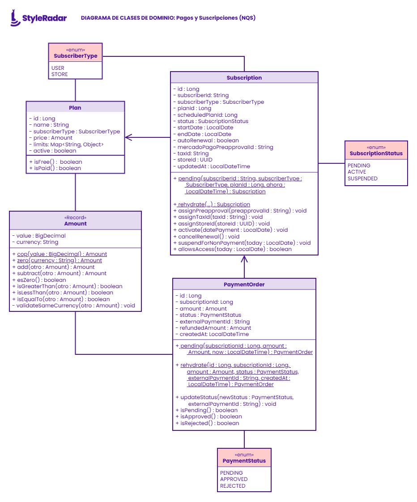
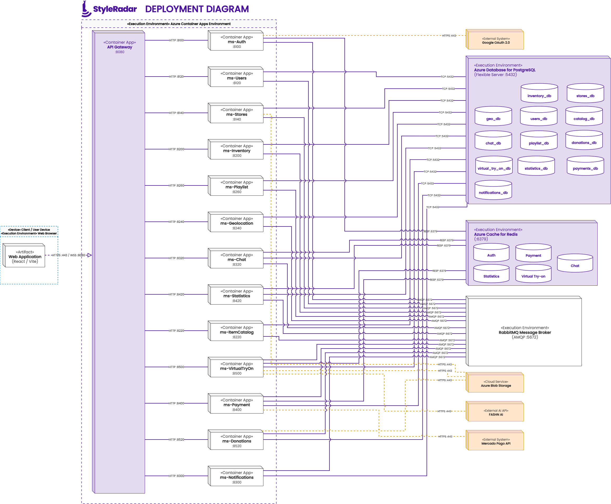

[⬅ Volver al README Principal](../../README.md)

---

##  2. ARQUITECTURA HEXAGONAL CON SUS DIAGRAMAS

El microservicio `NQS-Payment-Service` (`ms-pagos-suscripciones`) implementa rigurosamente **Arquitectura Hexagonal (Puertos y Adaptadores)** en conjunto con principios de **Domain-Driven Design (DDD)**. El núcleo de negocio permanece 100% puro en Java, completamente desacoplado de dependencias tecnológicas, frameworks web, motores de persistencia o brokers de mensajería.

---

### Diagramas del Microservicio

---

#### 2.1 Diagrama de Componentes General (Ecosistema StyleRadar)

<div align="center">
  
</div>

##### Justificación y Explicación Técnica de la Arquitectura del Ecosistema

Este diagrama modela la vista general de la arquitectura del backend de **StyleRadar**, posicionando a nuestro microservicio (`ms-Payment`) dentro de la red global de 13 microservicios y delimitando con precisión las fronteras de comunicación:

* **Puerta de Entrada Perimetral (API Gateway):**
  * Todas las solicitudes originadas desde la aplicación cliente (`StyleRadar Client Web App`) ingresan a través del **API Gateway** perimetral (puerto `8080`).
  * El Gateway actúa como proxy inverso y fachada perimetral única, centralizando la terminación TLS, el enrutamiento inteligente hacia la red privada de microservicios y la inyección de cabeceras de contexto (`X-User-Id`), aislando por completo la red interna de accesos no autorizados.

* **Ecosistema de 13 Microservicios Autónomos:**
  * La plataforma distribuye sus dominios de negocio en 13 servicios independientes bajo nomenclatura unificada:
    - **Paquete 1 (Identidad):** `ms-Auth` (:8100), `ms-Users` (:8120) y `ms-Stores` (:8140).
    - **Paquete 2 (Catálogo):** `ms-Inventory` (:8200), `ms-ItemCatalog` (:8220), `ms-Playlist` (:8260) y `ms-Geolocation` (:8240).
    - **Paquete 3 (Mensajería y Notificaciones):** `ms-Notifications` (:8300) y `ms-Chat` (:8320).
    - **Paquete 4 (Financiero y Analítica):** `ms-Payment` (:8400) y `ms-Statistics` (:8420).
    - **Paquete 5 (Experiencia y Moda Sostenible):** `ms-VirtualTryOn` (:8500) y `ms-Donations` (:8520).
  * Dentro de esta malla, nuestro servicio `ms-Payment` encapsula las responsabilidades relacionadas con la gestión de pagos asociados a las suscripciones de StyleRadar.

* **Aislamiento Estricto de Persistencia (*Database-per-Service*):**
  * Cada microservicio administra su propio esquema de base de datos PostgreSQL de forma 100% aislada en 12 bases relacionales (`virtual_try_on_db`, `users_db`, `stores_db`, `notifications_db`, `inventory_db`, `catalog_db`, `donations_db`, `chat_db`, `playlist_db`, `payments_db`, `geo_db` y `statistics_db`; `ms-Auth` no requiere base relacional).
  * No existen consultas cruzadas ni llaves foráneas físicas inter-servicio; las referencias se mantienen mediante identificadores lógicos inmutables (UUID), garantizando alta disponibilidad y escalabilidad horizontal independiente.

* **Capa de Aceleración en Memoria con Redis:**
  * Un clúster de **Redis** proporciona almacenamiento volátil de lectura ultrarrápida en memoria (< 3 ms) organizado en 5 particiones lógicas (`Auth`, `Payment`, `Chat`, `Statistics` y `Virtual Try-on`).

* **Comunicación Asíncrona Orientada a Eventos (RabbitMQ):**
  * La mensajería asíncrona desacopla flujos de alta latencia o dependencias multidireccionales mediante brokers y colas dedicadas (`RabbitMQ Usuarios`, `RabbitMQ Notificaciones`, `RabbitMQ ItemCatalogo`, `RabbitMQ Pagos`, `RabbitMQ Geolocalizacion`, `RabbitMQ Estadisticas`).

---

#### 2.2 Diagrama de Componentes Específico (Arquitectura Hexagonal NQS)

<div align="center">
  
</div>

##### Justificación y Explicación Técnica de la Arquitectura Interna

Este diagrama detalla la anatomía interna de `NQS-Payment-Service`, diseñado bajo **Arquitectura Hexagonal (Puertos y Adaptadores)** y principios de Domain-Driven Design (DDD). El flujo operativo avanza desde los puntos de entrada HTTP/Webhook hacia los casos de uso y servicios de aplicación, apoyándose en validaciones de seguridad/idempotencia y adaptadores de salida hacia la base de datos relacional, caché, pasarela de pagos y mensajería asíncrona.

* **Adaptadores de Entrada (`infrastructure.adapter.in`):**
  * **`AdminPaymentController:`** Atiende consultas administrativas de pagos.

  * **`PaymentController:`** Gestiona las peticiones asociadas a reintentos y consultas de historial.

  * **`PlanController:`** Administra las consultas vinculadas a los planes disponibles.

  * **`SubscriptionController:`** Expone los endpoints para gestionar suscripciones (iniciar, cancelación/desactivación de renovación automática y consulta).

  * **`WebhookController:`** Se comunica con la pasarela de pagos.

* **Puertos de Entrada de Aplicación (`application.port.in`):**
  * `AdminPaymentUseCase`, `PaymentUseCase`, `PlanUseCase`, `SubscriptionUseCase` y `WebhookUseCase` definen las operaciones de negocio orquestadas a partir de las solicitudes entrantes.

* **Servicios de Aplicación (`application.service`):**
  * **`SubscriptionActivationService:`** Servicio de aplicación enfocado en la lógica de activación de las suscripciones.

* **Validación:**

  * **`MercadoPagoSignatureValidator:`** Valida la autenticidad/firma de las notificaciones entrantes provenientes de Mercado Pago antes de procesarlas como eventos válidos.

* **Adaptadores de Salida (`infrastructure.adapter.out`):**
  Aíslan al núcleo de negocio de la infraestructura tecnológica mediante puertos de salida:

  * **`Adaptadores de persistencia relacional:`** `PaymentOrderPersistenceAdapter`, `SubscriptionPersistenceAdapter`, `PlanPersistenceAdapter` y `WebhookLogPersistenceAdapter` conectan la capa de aplicación con sus respectivos repositorios JPA (`PaymentOrderJpaRepository`, `SubscriptionJpaRepository`, `PlanJpaRepository`, `WebhookLogJpaRepository`) sobre la base de datos `styleradar_pagos`.

  * **`RedisIdempotencyAdapter:`** Coordina con Redis el control de idempotencia para evitar procesar duplicados (como reintentos de webhooks o peticiones repetidas).
  
  * **`RabbitEventPublisherAdapter:`** Publica eventos de dominio hacia RabbitMQ 3.13, permitiendo que otros servicios del ecosistema como ms-usuarios y ms-tiendas reaccionen de forma asíncrona a los cambios de planes, pagos o suscripciones.

---

#### 2.3 Diagrama de Clases del Modelo de Dominio

<div align="center">
  
</div>

##### Justificación y Explicación Técnica del Modelo de Dominio

Este diagrama modela el núcleo de dominio puro en Java (sin anotaciones de Spring, JPA ni dependencias de frameworks externos):

* **`Subscription:`**

  * Modela el ciclo de vida y el estado de las suscripciones vinculadas a un suscriptor (`subscriberId`, `subscriberType`, `storeId`) y a un plan (`planId`, `scheduledPlanId`), junto con datos de facturación y recurrencia (`status`, `startDate`, `endDate`, `autoRenewal`, `mercadoPagoPreapprovalId`, `taxId`, `updatedAt`).

  * `assignPreapproval(...)`, `assignTaxId(...`) y `assignStoreId(...)`: Encapsulan la vinculación de identificadores externos de pasarela, fiscales y de tienda.

  * `activate(datePayment)`: Activa la suscripción a partir de la fecha de pago confirmada.

  * `cancelRenewal()`: Desactiva la renovación automática (autoRenewal) sin romper el estado vigente.

  * `suspendForNonPayment(today)`: Suspende la suscripción ante falta de pago.

  * `allowsAccess(today)`: Evalúa si la suscripción habilita el acceso en la fecha consultada.

* **`Plan:`** 
  * Representa la oferta de plan (`id`, `name`, `subscriberType`, `price`, `limits`, `active`) y expone consultas de dominio como `isFree()` e `isPaid()` para distinguir planes gratuitos de planes de pago.

* **`PaymentOrder:`** 
  * Modela cada orden de pago asociada a una suscripción (`id`, `subscriptionId`, `amount`, `status`, `externalPaymentId`, `refundedAmount`, `createdAt`), con fábricas como `pending(...)` y `rehydrate(...)`, actualización de estado vía `updateStatus(...)` y consultas de estado (`isPending()`, `isApproved()`, `isRejected()`).

* **`Amount («Record»):`** Encapsula el monto monetario (`value: BigDecimal`) y la moneda (`currency: String`) de forma inmutable. 

* **`Enumeraciones de Dominio:`**

  * **`SubscriberType:`** Distingue el tipo de suscriptor (`USER`, `STORE`).

  * **`SubscriptionStatus:`** Define los estados posibles de una suscripción (`PENDING`, `ACTIVE`, `SUSPENDED`).

  * **`PaymentStatus:`** Define los estados posibles de una orden de pago (`PENDING`, `APPROVED`, `REJECTED`).

---

#### 2.4 Diagrama de Base de Datos

<div align="center">
  
</div>

##### Justificación y Explicación Técnica del Diseño Físico de Persistencia

Este diagrama modela el esquema relacional físico de persistencia en styleradar_pagos para el módulo de Pagos y Suscripciones (NQS):

* **Tablas Relacionales del Microservicio:**

  1. **`plans:`** Define los planes disponibles.

  2. **`subscriptions:`** Registra el ciclo de vida y vigencia de cada suscripción.

  3. **`payment_orders:`** Custodia las transacciones asociadas a una suscripción.

  4. **`webhook_logs:`** Registra notificaciones entrantes de la pasarela con fines de auditoría.

  5. **`event_outbox:`** Garantiza la publicación confiable de eventos de dominio.

* **Cardinalidades:**

  * `plans` (1) ── define plan / plan programado (1:N) ──> `subscriptions`

  * `subscriptions` (1) ── genera cobros (1:N) ──> `payment_orders`

  * `webhook_logs` y `event_outbox` operan como tablas independientes de soporte para auditoría de webhooks y mensajería transaccional (Transactional Outbox), optimizadas con índices en consultas de estado, fecha y reintentos.

---

#### 2.5 Diagrama de Despliegue General (Topología de Infraestructura y Contenedores)

<div align="center">
  
</div>

##### Justificación y Explicación Técnica de la Infraestructura de Despliegue

Este diagrama describe la topología física, el confinamiento de red y la arquitectura de infraestructura en la nube para toda la plataforma **StyleRadar** (Microsoft Azure PaaS / Contenedores OCI):

* **1. Capa de Cliente y Acceso Seguro (`«Device» Client / User Device`):**
  * La aplicación cliente web (`«Artifact» Web Application (React / Vite)`) se ejecuta dentro del navegador del usuario (`«Execution Environment» Web Browser`).
  * Se conecta de forma segura a través de **`HTTPS :443`** (para peticiones REST) y **`WSS :8080`** (WebSockets) hacia el contenedor perimetral **`«Container App» API Gateway :8080`**.
  * El Gateway es el único punto de ingreso con Ingress público expuesto al exterior, centralizando la terminación TLS y enrutando hacia la red privada interna.

* **2. Entorno de Microservicios (`«Execution Environment» Azure Container Apps Environment`):**
  Cada microservicio se ejecuta de manera independiente como una `«Container App»` en una red virtual privada sin exposición pública, comunicándose con el API Gateway mediante enlaces HTTP síncronos en puertos dedicados:
  * `ms-Auth` (:8100 · `HTTP :8100`) — Autenticación federada y emisión de tokens.
  * `ms-Users` (:8120 · `HTTP :8120`) — Gestión de perfiles y medidas corporales.
  * `ms-Stores` (:8140 · `HTTP :8140`) — Gestión de comercios aliados y sedes.
  * `ms-Inventory` (:8200 · `HTTP :8200`) — Control de inventario y stock físico en tiempo real.
  * `ms-Playlist` (:8260 · `HTTP :8260`) — Playlists de moda y recomendaciones personalizadas.
  * `ms-Geolocation` (:8240 · `HTTP :8240`) — Búsqueda geográfica y proximidad de tiendas.
  * `ms-Chat` (:8320 · `HTTP :8320`) — Mensajería interactiva cliente-comercio.
  * `ms-Statistics` (:8420 · `HTTP :8420`) — Métricas de interacción y telemetría analítica.
  * `ms-ItemCatalog` (:8220 · `HTTP :8220`) — Fichas técnicas de prendas y prendas disponibles.
  * `ms-VirtualTryOn` (:8500 · `HTTP :8500`) — Probador virtual
  * `ms-Payment` (:8400 · `HTTP :8400`) — **Nuestro microservicio**. Pasarela transaccional de pagos y suscripciones.
  * `ms-Donations` (:8520 · `HTTP :8520`) — Gestión de donaciones de ropa y economía circular *(puerto diferenciado, resolviendo colisión previa)*.
  * `ms-Notifications` (:8300 · `HTTP :8300`) — Despacho de notificaciones push y correos transaccionales.

* **3. Persistencia Relacional Gestionada (`«Execution Environment» Azure Database for PostgreSQL` · `:5432`):**
  * Servidor PostgreSQL Flexible Server que aloja **12 bases de datos lógicas independientes** conectadas mediante **`TCP :5432`**:
    `virtual_try_on_db`, `users_db`, `stores_db`, `notifications_db`, `inventory_db`, `catalog_db`, `donations_db`, `chat_db`, `playlist_db`, `payments_db`, `geo_db` y `statistics_db`.
  * `ms-Auth` no posee base de datos relacional (gestiona sesiones y tokens en caché).

* **4. Aceleración en Memoria (`«Execution Environment» Azure Cache for Redis` · `:6379`):**
  * Clúster en memoria conectado mediante protocolo **`RESP :6379`** con 5 particiones lógicas dedicadas: `Auth`, `Payment`, `Chat`, `Statistics` y `Virtual Try-on`.
  * `ms-VirtualTryOn` consume la partición `Virtual Try-on` para validación de cuotas mensuales en milisegundos (< 3 ms) y candados de concurrencia e idempotencia.

* **5. Broker de Mensajería Asíncrona (`«Execution Environment» RabbitMQ Message Broker` · `:5672`):**
  * Broker de eventos conectado mediante protocolo estándar **`AMQP :5672`** con los **13 microservicios**, asegurando el desacoplamiento de procesos asíncronos y tolerancia a fallos.

* **6. Proveedores y Servicios Externos en la Nube (SaaS · `HTTPS :443`):**
  * **`Google OAuth 2.0` (`«External System»`):** Conectado a `ms-Auth`.
  * **`Mercado Pago API` (`«External System»`):** Conectado a `ms-Payment`.
  * **`Azure Blob Storage` (`«Cloud Service»`):** Conectado a `ms-Stores`, `ms-Donations` y `ms-VirtualTryOn`.
  * **`FASHN AI` (`«External AI API»`):** Conectado a `ms-VirtualTryOn`.

---

### Estructura Oficial de Paquetes en `src/main/java/edu/dosw/styleradar/payments/`

```text
src/main/java/edu/dosw/styleradar/payments/
├── PaymentsApplication.java                                    <-- Punto de entrada Spring Boot
├── domain/                                                     <-- NÚCLEO DE DOMINIO (Java Puro, reglas de negocio)
│   ├── model/                                                  <-- Modelos y enums (Subscription, PaymentOrder, Plan, Amount, SubscriberType, SubscriptionStatus, PaymentStatus)
│   ├── event/                                                  <-- Eventos de dominio (PaymentConfirmedEvent, SubscriptionSuspendedEvent)
│   └── exception/                                              <-- Excepciones de negocio (PaymentsException, SubscriptionNotFoundException, etc.)
├── application/                                                <-- CAPA DE APLICACIÓN (Casos de uso, puertos y orquestación)
│   ├── port/
│   │   ├── in/                                                 <-- Puertos de entrada (SubscriptionPort, PaymentPort, PlanPort, WebhookPort, AdminPaymentPort)
│   │   └── out/                                                <-- Puertos de salida (MercadoPagoPort, EventPublisherPort, IdempotencyPort, repositorios y WebhookLogPort)
│   ├── usecase/                                                <-- Casos de uso (SubscriptionUseCase, PaymentUseCase, PlanUseCase, WebhookUseCase, AdminPaymentUseCase)
│   ├── service/                                                <-- Servicios y schedulers (SubscriptionActivationService, SubscriptionScheduler, ReconciliationScheduler, helpers)
│   └── dto/                                                    <-- DTOs de entrada/salida (request/* y response/*)
└── infrastructure/                                             <-- CAPA DE INFRAESTRUCTURA (Adaptadores, seguridad y configuración)
    ├── adapter/
    │   ├── in/rest/                                            <-- Controladores REST y validación de firma (SubscriptionController, PaymentController, PlanController, WebhookController, AdminPaymentController, HealthController, MercadoPagoSignatureValidator)
    │   └── out/
    │       ├── payment/                                        <-- Integración Mercado Pago (MercadoPagoAdapter, MercadoPagoFeignClient, MockMercadoPagoAdapter, dto/*)
    │       ├── messaging/                                      <-- Publicación y Outbox/RabbitMQ (RabbitEventPublisherAdapter, OutboxEventPublisherAdapter, OutboxPublisherScheduler, NoOpEventPublisherAdapter)
    │       ├── persistence/                                      <-- Adaptadores JPA, entidades y repositorios (SubscriptionPersistenceAdapter, PaymentOrderPersistenceAdapter, PlanPersistenceAdapter, WebhookLogPersistenceAdapter, PersistenceMapper, entity/*, repository/*)
    │       └── cache/                                          <-- Idempotencia en Redis (RedisIdempotencyAdapter)
    ├── config/                                                 <-- Configuración Spring/AMQP/OpenAPI/JWT/Seed (RabbitMQConfig, OpenApiConfig, JwtProperties, ClockConfig, DemoPlanSeeder)
    ├── exception/                                              <-- Manejo global de excepciones (GlobalExceptionHandler)
    └── security/                                               <-- Seguridad y autenticación entre servicios (SecurityConfig, ServiceAuthenticationFilter, SecurityErrorWriter)
```

---

[⬅ Volver al README Principal](../../README.md)