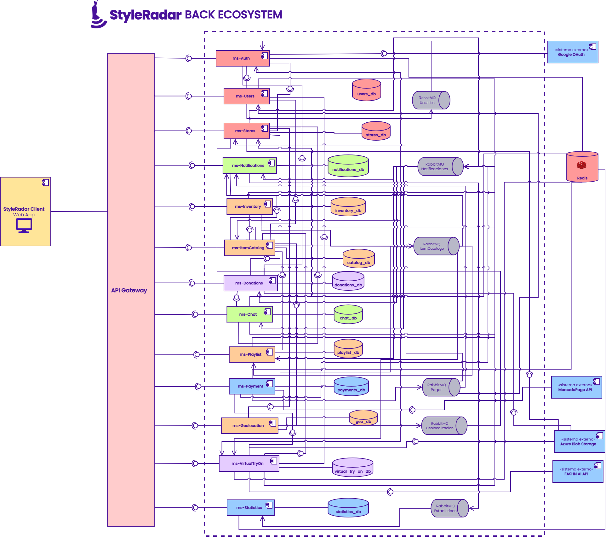
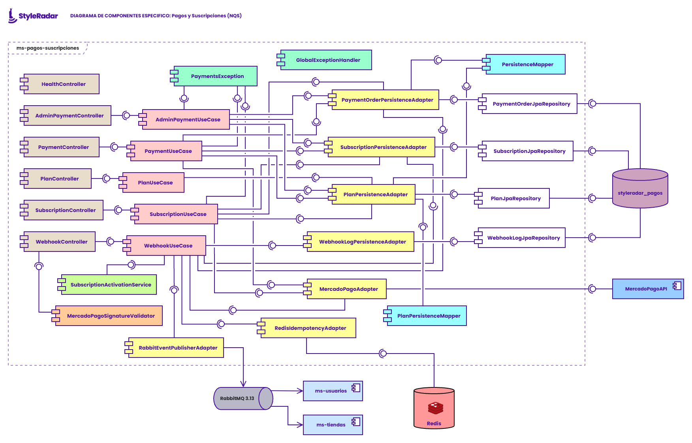
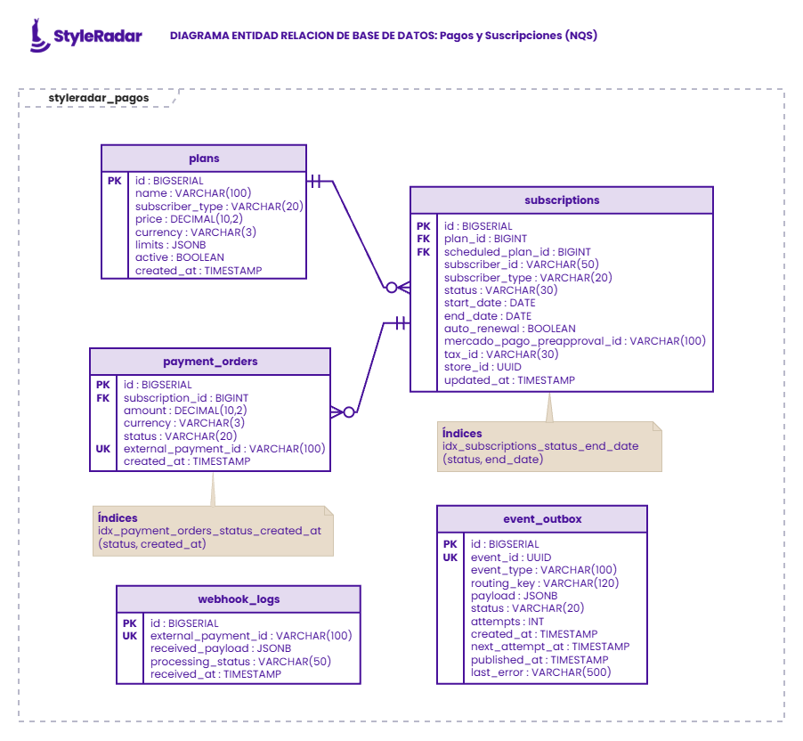
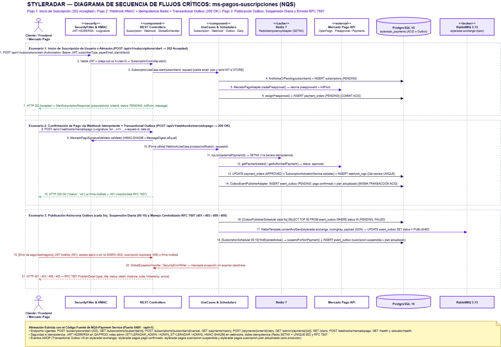

[⬅ Volver al README Principal](../../README.md)

---

## 2. ARQUITECTURA HEXAGONAL CON SUS DIAGRAMAS

El microservicio `NQS-Payment-Service` (`ms-pagos-suscripciones`) implementa rigurosamente **Arquitectura Hexagonal (Puertos y Adaptadores)** combinada con **Domain-Driven Design (DDD)**. El núcleo de dominio (`domain`) permanece 100% puro en Java, sin dependencias de frameworks web, JPA, Redis ni RabbitMQ.

---

### Diagramas del Microservicio

---

#### 2.1 Diagrama de Componentes General (Ecosistema StyleRadar)

<div align="center">
  
</div>

##### Justificación y Explicación Técnica de la Arquitectura del Ecosistema

Este diagrama modela la vista general de la arquitectura del backend de **StyleRadar**, ubicando a `ms-Payment` (`ms-pagos-suscripciones`, puerto `8400`) dentro de la malla de 13 microservicios autónomos:

* **Puerta de Entrada Perimetral (API Gateway):** Centraliza la terminación TLS, la validación inicial de sesión y el enrutamiento hacia los microservicios internos, dirigiendo las peticiones de suscripciones y pagos hacia `:8400`.
* **Ecosistema de 13 Microservicios y Paquete 4:** `ms-Payment` pertenece al Paquete 4 (Financiero y Analítica) junto con `ms-Statistics` (`:8420`). Expone contratos síncronos REST para consulta de planes, suscripciones y pagos, y publica eventos asíncronos hacia el bus de eventos.
* **Aislamiento *Database-per-Service*:** Opera exclusivamente sobre su propia base de datos PostgreSQL 16 (`styleradar_payments`), sin compartir tablas ni llaves foráneas físicas con otros microservicios.
* **Aceleración e Idempotencia en Redis:** Utiliza Redis 7 para garantizar idempotencia atómica (`SETNX`) en la recepción de webhooks y evitar reprocesamientos concurrentes.
* **Comunicación Asíncrona vía RabbitMQ:** Publica eventos de confirmación de pago, suspensión por falta de pago y actualización de plan sobre `styleradar.exchange`, desacoplando a `ms-item-catalogo` y `ms-estadisticas`.
* **Integración Externa:** Se comunica exclusivamente por HTTPS con la **API de Mercado Pago** para crear preaprobaciones, consultar pagos y cancelar renovaciones automáticas, y recibe notificaciones webhook firmadas con HMAC-SHA256.

---

#### 2.2 Diagrama de Componentes Específico (Arquitectura Hexagonal NQS)

<div align="center">
  
</div>

##### Justificación y Explicación Técnica de la Arquitectura Interna

Este diagrama detalla la anatomía interna de `NQS-Payment-Service` bajo **Arquitectura Hexagonal (Puertos y Adaptadores)**:

* **Adaptadores de Entrada (`infrastructure.adapter.in.rest`):**
  * `SubscriptionController`, `PaymentController`, `AdminPaymentController`, `PlanController`, `WebhookController` y `HealthController`.
  * `MercadoPagoSignatureValidator` valida la firma HMAC-SHA256 (`x-signature`) de los webhooks entrantes antes de delegar al caso de uso.
  * `ServiceAuthenticationFilter` y `SecurityConfig` protegen las rutas con JWT/roles y `GlobalExceptionHandler` normaliza errores bajo RFC 7807 (`ProblemDetail`).
* **Puertos de Entrada y Casos de Uso (`application.port.in`, `application.usecase`):**
  * `SubscriptionPort` / `SubscriptionUseCase`, `PaymentPort` / `PaymentUseCase`, `AdminPaymentPort` / `AdminPaymentUseCase`, `PlanPort` / `PlanUseCase` y `WebhookPort` / `WebhookUseCase`.
* **Servicios de Aplicación (`application.service`):**
  * `SubscriptionActivationService` encapsula la activación o extensión de vigencia tras pago aprobado.
  * `SubscriptionScheduler` (suspensión diaria a las `00:10`) y `ReconciliationScheduler` (conciliación diaria de órdenes pendientes a las `03:00`).
  * `Roles`, `EmailValidator` y `PaymentStatusMapper` proveen utilidades de dominio/aplicación reutilizables.
* **Puertos de Salida y Adaptadores (`application.port.out`, `infrastructure.adapter.out`):**
  * **Persistencia (`persistence`):** `PlanPersistenceAdapter`, `SubscriptionPersistenceAdapter`, `PaymentOrderPersistenceAdapter` y `WebhookLogPersistenceAdapter` sobre Spring Data JPA y PostgreSQL 16.
  * **Pasarela (`payment`):** `MercadoPagoAdapter` (vía `MercadoPagoFeignClient`) y `MockMercadoPagoAdapter` (para perfiles `dev`/`test`).
  * **Caché (`cache`):** `RedisIdempotencyAdapter` con `SETNX`.
  * **Mensajería (`messaging`):** `OutboxEventPublisherAdapter` (`@Primary`), `OutboxPublisherScheduler` (publicación asíncrona cada 5s a `RabbitTemplate`) y `NoOpEventPublisherAdapter` (perfil `test`).

---

#### 2.3 Diagrama de Clases del Modelo de Dominio

<div align="center">
  
</div>

##### Justificación y Explicación Técnica del Modelo de Dominio

El núcleo de dominio en `edu.dosw.styleradar.payments.domain` modela las entidades, value objects, enumeraciones, eventos y excepciones de negocio en Java puro:

* **`Subscription`:** Agregado principal que representa una suscripción de usuario o almacén. Encapsula sus transiciones e invariantes mediante `pending(...)`, `rehydrate(...)`, `assignPreapproval(...)`, `assignTaxId(...)`, `assignStoreId(...)`, `activate(...)`, `cancelRenewal()`, `suspendForNonPayment(...)`, `isInForce(...)`, `allowsAccess(...)`, `isPending()`, `isActive()` y `isSuspended()`.
* **`PaymentOrder`:** Entidad que representa una orden de cobro asociada a una suscripción, con métodos `pending(...)`, `rehydrate(...)`, `updateStatus(newStatus, externalPaymentId)`, `isPending()`, `isApproved()` e `isRejected()`.
* **`Plan`:** Entidad inmutable que define el catálogo de planes (`Radar`, `Radar+`, `Store Basic`), precio, límites en `Map<String, Object>` y métodos `free(...)`, `isFree()`, `esDePayment()` e `isOfType(...)`.
* **`Amount` (Record Value Object):** Encapsula `BigDecimal value` (escala 2 `HALF_UP`, no negativo) y código ISO 4217 `String currency`, con operaciones aritméticas y de comparación seguras (`cop(...)`, `zero(...)`, `add(...)`, `subtract(...)`, `esZero()`, `isGreaterThan(...)`, `isLessThan(...)`, `isEqualTo(...)`).
* **Enumeraciones:**
  * `SubscriberType`: `USER`, `STORE` (con `legacyValue()` hacia `USUARIO`/`ALMACEN` para compatibilidad de eventos).
  * `SubscriptionStatus`: `PENDING`, `ACTIVE`, `SUSPENDED`.
  * `PaymentStatus`: `PENDING`, `APPROVED`, `REJECTED` (el estado `REFUNDED` fue retirado en `V9`).
* **Eventos de Dominio (`domain.event`):** Records `PaymentConfirmedEvent`, `SubscriptionSuspendedEvent` y `SubscriptionPlanUpdatedEvent`.

---

#### 2.4 Diagrama Entidad-Relación de Base de Datos (`styleradar_payments` · PostgreSQL 16)

<div align="center">
  
</div>

##### Justificación y Explicación Técnica del Diseño Físico de Persistencia

El esquema físico en **PostgreSQL 16** (`styleradar_payments`) evoluciona de forma reproducible mediante **Flyway (`V1`–`V9`)** con todas las tablas y columnas normalizadas en inglés (`V6`), almacenamiento de eventos outbox (`V8`) y retiro de columnas de reembolso (`V9`):

* **Tablas del Esquema:**
  1. **`plans`:** Catálogo de planes (`id`, `name`, `subscriber_type`, `price`, `currency`, `limits` JSONB, `active`, `created_at`).
  2. **`subscriptions`:** Suscripciones de usuarios y almacenes (`id`, `plan_id`, `scheduled_plan_id`, `subscriber_id`, `subscriber_type`, `status`, `start_date`, `end_date`, `auto_renewal`, `mercado_pago_preapproval_id`, `tax_id`, `store_id`, `updated_at`).
  3. **`payment_orders`:** Órdenes de pago (`id`, `subscription_id`, `amount`, `currency`, `status`, `external_payment_id`, `created_at`).
  4. **`webhook_logs`:** Registro auditable e idempotente de notificaciones recibidas (`id`, `external_payment_id`, `received_payload` JSONB, `processing_status`, `received_at`).
  5. **`event_outbox` (`V8`):** Cola transaccional de eventos salientes (`id`, `event_id`, `event_type`, `routing_key`, `payload` JSONB, `status`, `attempts`, `created_at`, `next_attempt_at`, `published_at`, `last_error`).

* **Reglas e Índices Relevantes:**
  * `plans.subscriber_type` ∈ `USER`/`STORE`; `plans.price >= 0`.
  * `subscriptions.subscriber_type` ∈ `USER`/`STORE`; `subscriptions.status` ∈ `PENDING`/`ACTIVE`/`SUSPENDED`.
  * Índice único parcial `uq_active_pending_subscription` sobre `subscriptions (subscriber_id) WHERE status IN ('ACTIVE', 'PENDING')`: impide que un suscriptor tenga dos suscripciones activas o pendientes simultáneas.
  * `payment_orders.status` ∈ `PENDING`/`APPROVED`/`REJECTED`; `payment_orders.amount >= 0`.
  * `payment_orders.external_payment_id` y `webhook_logs.external_payment_id` son `UNIQUE`: segunda barrera de idempotencia ante webhooks duplicados.
  * `event_outbox.status` ∈ `PENDING`/`PUBLISHED`/`FAILED` con índice `idx_event_outbox_status_next_attempt` sobre `(status, next_attempt_at)` para el polling del scheduler.

---

#### 2.5 Diagrama de Despliegue General (Topología de Infraestructura y Contenedores)

<div align="center">
  
</div>

##### Justificación y Explicación Técnica de la Infraestructura de Despliegue

Este diagrama describe la topología de despliegue de StyleRadar y la conectividad específica de `ms-pagos-suscripciones` en **Azure Container Apps**:

* **Ingress:** Tráfico HTTP en puerto `8400` desde el API Gateway / entorno Container Apps.
* **Persistencia:** Conexión JDBC TCP (`5432`, SSL requerido en QA/PROD) hacia PostgreSQL 16 (`styleradar_payments`).
* **Caché:** Conexión RESP (`6379` local / `6380` SSL en Azure Cache for Redis) para control de idempotencia.
* **Mensajería:** Conexión AMQP (`5672` local / `5671` AMQPS TLS con truststore PKCS12 en QA/PROD) hacia RabbitMQ 3.13 (`styleradar.exchange`).
* **Proveedor Externo:** Conexión HTTPS (`443`) saliente hacia `https://api.mercadopago.com` y recepción de webhooks firmados.

---

#### 2.6 Diagrama de Secuencia de Flujos Críticos (Suscripción, Webhook Idempotente y Outbox)

<div align="center">
  
</div>

##### Justificación y Explicación Técnica de los Flujos de Ejecución

Este diagrama detalla las interacciones críticas en tiempo de ejecución:

1. **Inicio de Suscripción (`POST /api/v1/subscriptions/start` → `202 Accepted`):** Valida identidad, verifica ausencia de suscripción activa/pendiente, crea la suscripción `PENDING` y la orden de pago, invoca a Mercado Pago para generar la preaprobación y retorna el `initPoint`.
2. **Confirmación vía Webhook (`POST /api/v1/webhooks/mercadopago` → `200 OK`):** Valida HMAC-SHA256 (`x-signature`), adquiere candado de idempotencia en Redis (`SETNX`), consulta el pago en Mercado Pago, actualiza `payment_orders` a `APPROVED`, activa o extiende la suscripción y guarda los eventos en `event_outbox` dentro de la misma transacción.
3. **Publicación Asíncrona (Transactional Outbox) y Suspensión Programada:** `OutboxPublisherScheduler` lee eventos `PENDING`/`FAILED` cada 5s y los publica a RabbitMQ; `SubscriptionScheduler` (`00:10`) suspende suscripciones vencidas y encola los eventos de suspensión y cambio de plan.

---

### Estructura Oficial de Paquetes en `src/main/java/edu/dosw/styleradar/payments/`

```text
src/main/java/edu/dosw/styleradar/payments/
├── PaymentsApplication.java                         <-- Punto de entrada Spring Boot + @EnableScheduling + @EnableFeignClients
├── domain/                                          <-- NÚCLEO DE DOMINIO (Java puro, cero dependencias de frameworks)
│   ├── model/                                       <-- Entidades y Value Objects (Plan, Subscription, PaymentOrder, Amount, SubscriberType, SubscriptionStatus, PaymentStatus)
│   ├── event/                                       <-- Eventos de dominio (PaymentConfirmedEvent, SubscriptionSuspendedEvent, SubscriptionPlanUpdatedEvent)
│   └── exception/                                   <-- Excepciones semánticas y catálogo Messages
├── application/                                     <-- CAPA DE APLICACIÓN (Orquestación de Casos de Uso)
│   ├── dto/
│   │   ├── request/                                 <-- DTOs de entrada (StartSubscriptionRequest, CancelSubscriptionRequest, RetryPaymentRequest, NotificationPayment)
│   │   └── response/                                <-- DTOs de salida (StartSubscriptionResponse, SubscriptionResponse, PaymentResponse, PlanResponse, CancellationResponse, RetryPaymentResponse, AmountResponse)
│   ├── port/
│   │   ├── in/                                      <-- Puertos de entrada (SubscriptionPort, PaymentPort, AdminPaymentPort, PlanPort, WebhookPort)
│   │   └── out/                                     <-- Puertos de salida (SubscriptionRepositoryPort, PaymentOrderRepositoryPort, PlanRepositoryPort, WebhookLogPort, MercadoPagoPort, IdempotencyPort, EventPublisherPort)
│   ├── service/                                     <-- Servicios y schedulers (SubscriptionActivationService, SubscriptionScheduler, ReconciliationScheduler, Roles, EmailValidator, PaymentStatusMapper)
│   └── usecase/                                     <-- Casos de uso (SubscriptionUseCase, PaymentUseCase, AdminPaymentUseCase, PlanUseCase, WebhookUseCase)
└── infrastructure/                                  <-- CAPA DE INFRAESTRUCTURA (Adaptadores, Seguridad y Configuración)
    ├── adapter/
    │   ├── in/
    │   │   └── rest/                                <-- Controladores REST (SubscriptionController, PaymentController, AdminPaymentController, PlanController, WebhookController, HealthController)
    │   │       └── security/                        <-- Validación HMAC de webhooks (MercadoPagoSignatureValidator)
    │   └── out/
    │       ├── cache/                               <-- Adaptador Redis SETNX (RedisIdempotencyAdapter)
    │       ├── messaging/                           <-- Outbox y RabbitMQ (OutboxEventPublisherAdapter, OutboxPublisherScheduler, RabbitEventPublisherAdapter, NoOpEventPublisherAdapter)
    │       ├── payment/                             <-- Cliente Mercado Pago OpenFeign y Mock (MercadoPagoAdapter, MercadoPagoFeignClient, MockMercadoPagoAdapter, dto/)
    │       └── persistence/                         <-- Adaptadores JPA, mapper, entidades y repositorios (entity/, repository/, PersistenceMapper)
    ├── config/                                      <-- Configuración (ClockConfig, DemoPlanSeeder, JwtProperties, OpenApiConfig, RabbitMQConfig)
    ├── exception/                                   <-- Manejo global RFC 7807 (GlobalExceptionHandler)
    └── security/                                    <-- Seguridad stateless JWT (SecurityConfig, ServiceAuthenticationFilter, SecurityErrorWriter)
```

---

[⬅ Volver al README Principal](../../README.md)
