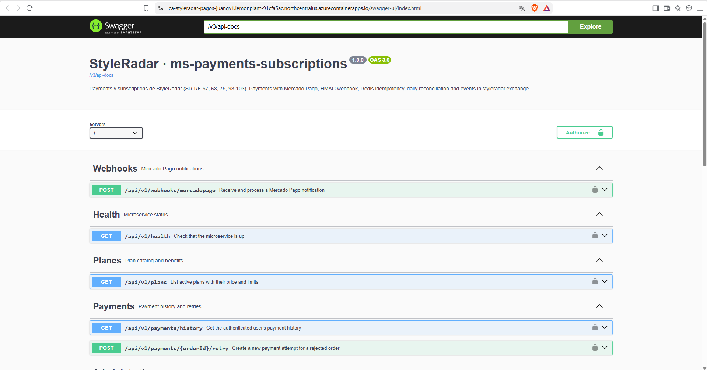

[⬅ Volver al README Principal](../../README.md)

---

##  3. ENDPOINTS Y ENLACE A SWAGGER (Corregir)

La documentación interactiva OpenAPI 3.0 y los contratos de ejecución se encuentran desplegados y clasificados por entorno:

### Matriz Oficial de Enlaces por Entorno (PROD, QA, LOCAL)

| Entorno | Estado | URL base | Swagger UI | Health |
| :--- | :---: | :--- | :--- | :--- |
| **QA** | Activo | `https://ca-styleradar-pagos-juangv1.lemonplant-91cfa5ac.northcentralus.azurecontainerapps.io` | [Swagger QA](https://ca-styleradar-pagos-juangv1.lemonplant-91cfa5ac.northcentralus.azurecontainerapps.io/swagger-ui/index.html) | [`/actuator/health`](https://ca-styleradar-pagos-juangv1.lemonplant-91cfa5ac.northcentralus.azurecontainerapps.io/actuator/health) |
| **PROD** | Pendiente | Pendiente de despliegue | Pendiente | Pendiente |
| **Local** | Local | `http://localhost:8400` | `http://localhost:8400/swagger-ui.html` | `http://localhost:8400/actuator/health` |

* **Especificación OpenAPI (Contrato JSON Schema):** `http://localhost:8400/v3/api-docs` (o `/v3/api-docs` en los dominios de PROD y QA).


<div align="center">
  

</div>

### Tabla de Endpoints Expuestos

| Método | Endpoint | Autorización | Éxito | Errores |
| :---: | :--- | :--- | :---: | :--- |
| `POST` | `/api/v1/suscripciones/iniciar` | JWT / `X-User-Id` | `201` | `400`, `403`, `422` |
| `GET` | `/api/v1/suscripciones/{suscriptorId}` | Titular o `ADMIN_STYLERADAR` | `200` | `401`, `403`, `404` |
| `POST` | `/api/v1/suscripciones/{suscriptorId}/cancelar` | Titular | `200` | `400`, `403`, `404`, `422` |
| `GET` | `/api/v1/pagos/historial` | JWT / `X-User-Id` | `200` | `401` |
| `POST` | `/api/v1/pagos/{ordenId}/reintentar` | Titular | `200` | `400`, `403`, `404`, `422` |
| `POST` | `/api/v1/pagos/{ordenId}/reembolsar` | `ADMIN_STYLERADAR` | `200` | `400`, `403`, `404`, `422` |
| `GET` | `/api/v1/admin/pagos?estado=` | `ADMIN_STYLERADAR` | `200` | `403` |
| `GET` | `/api/v1/planes` | Autenticado | `200` | `401` |
| `POST` | `/api/v1/webhooks/mercadopago` | HMAC `x-signature` | `200` | `400` |
| `GET` | `/api/v1/health` | Público | `200` | — |
| `GET` | `/actuator/health` | Público | `200`/`503` | — |
<details>
<summary><b>Ejemplos de request/response</b></summary>

<br>

**Crear suscripción de usuario**

```http
POST /api/v1/suscripciones/iniciar
Authorization: Bearer <JWT>
Content-Type: application/json
```

```json
{
  "tipoSuscriptor": "USUARIO",
  "emailPayer": "test_user_117646358391238183361@testuser.com",
  "planId": 2
}
```

```json
{
  "suscripcionId": 100,
  "ordenId": 10,
  "estado": "PENDIENTE",
  "initPoint": "https://www.mercadopago.com.co/subscriptions/checkout?preapproval_id=..."
}
```

**Crear suscripción de almacén**

```json
{
  "tipoSuscriptor": "ALMACEN",
  "emailPayer": "test_user_...@testuser.com",
  "nit": "900123456-7",
  "almacenId": "a1111111-1111-1111-1111-111111111111"
}
```

`almacenId` es obligatorio para `ALMACEN`: es el UUID que usa `ms-item-catalogo` para suspender el catálogo.

**Error estándar**

```json
{
  "timestamp": "2026-11-17T02:15:30.123",
  "status": 400,
  "error": "INVALID_STATE",
  "message": "La suscripción ya está activa. No se requiere reintentar el pago.",
  "path": "/api/v1/pagos/1/reintentar",
  "validationErrors": []
}
```

</details>


---

[⬅ Volver al README Principal](../../README.md)