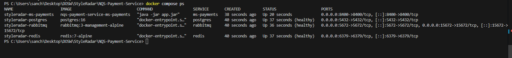

[⬅ Volver al README Principal](../../README.md)

---

## 6. CÓMO EJECUTAR LOCAL Y CON DOCKER

### Prerrequisitos de Entorno

* **Java Development Kit (JDK):** Versión 21 LTS instalada (`java -version`).
* **Apache Maven:** Versión 3.9+ instalada (`mvn -version`) — el repositorio utiliza `mvn` directamente (sin wrapper `mvnw`).
* **Docker Engine & Docker Compose:** Versión 24+ en ejecución (`docker --version`).

### Ejecución Local con Maven (Perfil Dev / Test)

```bash
# 1. Clonar el repositorio
git clone https://github.com/StyleRadar1/NQS-Payment-Service.git
cd NQS-Payment-Service

# 2. Levantar la infraestructura auxiliar (PostgreSQL, Redis, RabbitMQ)
docker compose up -d postgres redis rabbitmq

# 3. Ejecutar el microservicio localmente en el puerto 8400 (perfil dev)
mvn clean spring-boot:run -Dspring-boot.run.profiles=dev
```

> [!NOTE]
> **Parámetros de conexión al ejecutar con `mvn` desde el equipo host:**
> * **PostgreSQL (`styleradar_payments`):** `localhost:5432` · Usuario: `sr_user` · Contraseña: `sr_password`
> * **Redis Server:** `localhost:6379`
> * **RabbitMQ Broker:** `localhost:5672` (Management Dashboard en `http://localhost:15672`, credenciales `guest` / `guest`)
> * *En Windows (PowerShell), puedes exportar variables puntuales antes de arrancar si deseas sobreescribir el puerto:* `$env:SERVER_PORT="8400"`

### Perfiles de Spring Boot Disponibles

* **`dev`:** JWT desactivado, Mercado Pago mock (`TEST-MOCK` y firma `dummy`), RabbitMQ local sin TLS (`5672`).
* **`test`:** H2 en memoria (modo PostgreSQL), Flyway deshabilitado, Mercado Pago mock, RabbitMQ y JWT desactivados; ideal para probar endpoints sin infraestructura externa:
  ```bash
  mvn spring-boot:run -Dspring-boot.run.profiles=test
  ```
* **`qa`:** PostgreSQL, Redis (SSL `6380`) y RabbitMQ (AMQPS TLS `5671`) reales, JWT HS256 obligatorio y Mercado Pago sandbox.
* **`prod`:** Configuración productiva con PostgreSQL/Redis/RabbitMQ TLS, JWT HS256 obligatorio y `health.show-details: never`.

### Ejecución Contenerizada Completa con Docker Compose

El archivo `docker-compose.yml` orquesta la infraestructura junto al servicio `ms-payments` bajo el perfil `app`:

<details>
<summary><b>Click para ver Instrucciones de Docker y Contenedores Orquestados</b></summary>

<br>

> [!IMPORTANT]
> El `Dockerfile` ejecuta `COPY certs/ /app/certs/`. El repositorio incluye `certs/README.md` para que el directorio `certs/` exista en local y el build funcione sin errores (el truststore `.jks` solo es necesario al conectar con RabbitMQ TLS en QA/PROD).

```bash
# 1. Copiar plantilla de variables de entorno
cp .env.example .env

# 2. Levantar todos los servicios en segundo plano (build multi-stage + DB + Redis + RabbitMQ)
docker compose --profile app up -d --build

# 3. Verificar el estado de los contenedores
docker compose ps

# 4. Visualizar logs en tiempo real del microservicio
docker compose logs -f ms-payments

# 5. Detener los servicios
docker compose down
```

#### Conexión con `mvn` (host) vs. red interna de Docker Compose:

| Componente | Conexión con `mvn` (Host Local) | Conexión dentro de Docker Compose (Red Interna) |
| :--- | :--- | :--- |
| **PostgreSQL (`styleradar_payments`)** | `localhost:5432` (`jdbc:postgresql://localhost:5432/styleradar_payments`) | `postgres:5432` (`jdbc:postgresql://postgres:5432/styleradar_payments`) |
| **Redis Server** | `localhost:6379` | `redis:6379` |
| **RabbitMQ Broker** | `localhost:5672` | `rabbitmq:5672` |
| **Microservicio `ms-payments`** | `http://localhost:8400` | `http://ms-payments:8400` *(mapeado a `localhost:8400`)* |

</details>

### Comprobación de Salud (Health Check)

```bash
curl -s http://localhost:8400/actuator/health
# Esperado: {"status":"UP"}

curl -s http://localhost:8400/api/v1/health
```

<div align="center">
  
  <p><sub><b>Figura 6.1:</b> Ejecución de <code>docker compose ps</code> verificando los 4 contenedores OCI levantados y saludables: <code>styleradar-ms-payments</code> (:8400), <code>styleradar-postgres</code> (:5432), <code>styleradar-redis</code> (:6379) y <code>styleradar-rabbitmq</code> (:5672/15672).</sub></p>
</div>

---

[⬅ Volver al README Principal](../../README.md)
