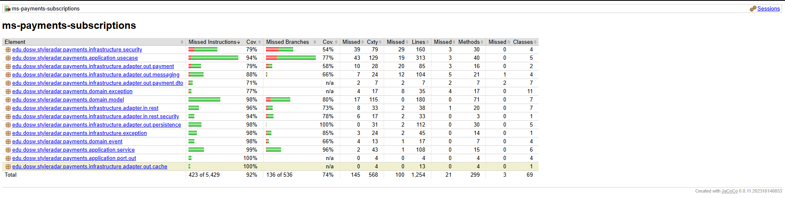

[⬅ Volver al README Principal](../../README.md)

---

## 8. PRUEBAS Y COBERTURA (≥ 85%)

El proyecto exige una cobertura de código mínima del **85%** verificada automáticamente mediante el plugin de **JaCoCo** durante la fase `verify` de Maven.

### Comandos de Ejecución de Pruebas

```bash
# Ejecutar la suite completa de pruebas unitarias y de integración + verificación JaCoCo
mvn clean verify

# Generar únicamente el reporte HTML de cobertura JaCoCo
mvn jacoco:report
```

* **Ruta del Reporte HTML:** `target/site/jacoco/index.html`

### Métricas Actuales de Cobertura en el Repositorio

* **Pruebas Totales Definidas:** **205 pruebas automatizadas** (`203 @Test` + `2 @ParameterizedTest`) distribuidas en 37 clases de prueba.
* **Fallos y Errores:** 0 fallos, 0 errores.
* **Cobertura de Instrucciones (`INSTRUCTION`):** **92%** registrada en el reporte JaCoCo (supera el umbral mínimo obligatorio del 85%).
* **Documentación de Seguridad y OWASP Top 10:2025:** [`../security/SR_NQS_Seguridad_y_OWASP_2025.md`](../security/SR_NQS_Seguridad_y_OWASP_2025.md).
* **Resultado del Build:** `BUILD SUCCESS`.

<div align="center">
  
  <p><sub><b>Figura 8.1:</b> Reporte consolidado de cobertura HTML generado por JaCoCo (<code>target/site/jacoco/index.html</code>), evidenciando un 92% de cobertura de instrucciones y superando el umbral exigido del 85%.</sub></p>
</div>

### Pirámide de Pruebas Implementada

| Nivel de Prueba | Alcance | Tecnologías Utilizadas | Ubicación en el Código | Cobertura Meta |
| :--------------------------------- | :--------------------------------------------------------------------------------------------- | :-------------------------------------- | :------------------------------------------------------------------------------------- | :------------: |
| **Pruebas de Dominio** | Agregados, invariantes, value objects y eventos (`PlanTest`, `SubscriptionTest`, `PaymentOrderTest`, `AmountTest`, `SubscriptionPlanUpdatedEventTest`) | JUnit 5, AssertJ | `src/test/java/edu/dosw/styleradar/payments/domain/` | ≥ 90% |
| **Pruebas Unitarias de Aplicación** | Casos de uso, schedulers, validación de email, roles y activación de suscripciones | JUnit 5, Mockito, AssertJ | `src/test/java/edu/dosw/styleradar/payments/application/` | ≥ 85% |
| **Pruebas de Contrato REST & Seguridad** | Controladores HTTP, manejo de excepciones RFC 7807, JWT y firma HMAC (`SecurityIntegrationTest`, `MercadoPagoSignatureValidatorTest`) | Spring Boot Test, MockMvc, Spring Security Test | `src/test/java/edu/dosw/styleradar/payments/infrastructure/adapter/in/rest/`, `.../security/`, `.../exception/` | ≥ 85% |
| **Pruebas de Integración & Persistencia** | Adaptadores JPA/Redis/Outbox/MercadoPago, migraciones reales en PostgreSQL (`PostgresMigrationTest`) y flujo extremo a extremo (`DemoFlowIntegrationTest`) | Spring Boot Test, H2, Testcontainers (`1.21.3`) | `src/test/java/edu/dosw/styleradar/payments/infrastructure/adapter/out/` | ≥ 85% |

> [!IMPORTANT]
> **Criterio de Fallo en CI:** El archivo `pom.xml` configura `jacoco-maven-plugin` con el contador `INSTRUCTION` y `<minimum>0.85</minimum>` en fase `verify` (excluyendo `PaymentsApplication.class`, `application/dto/**`, `infrastructure/adapter/out/persistence/entity/**` e `infrastructure/config/**`). Si la cobertura consolidada cae por debajo del 85%, `mvn clean verify` fallará y GitHub Actions bloqueará la integración.

---

[⬅ Volver al README Principal](../../README.md)
