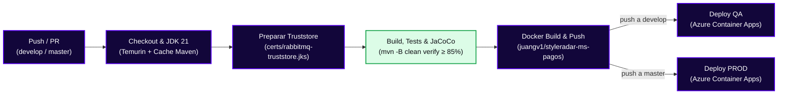
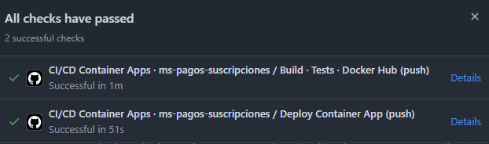

[⬅ Volver al README Principal](../../README.md)

---

## 9. CI/CD CON EL BADGE DEL PIPELINE

El ciclo de vida del microservicio implementa integración y entrega continua automatizada mediante **GitHub Actions** (`.github/workflows/ci.yml`), construyendo y publicando la imagen OCI en Docker Hub y desplegando hacia **Azure Container Apps**.

### Badges de Pipelines y Calidad (GitHub Actions)

  
  
  
  

### Matriz de Pipelines por Rama Protegida

| Job (`ci.yml`) | Rama / Entorno | Trigger de Ejecución | Qué Hace / Quality Gate | Estado |
| :--- | :---: | :--- | :--- | :---: |
| **`build-and-push`** | `develop`, `master` | `push` a `develop` o `master`, y `pull_request` hacia `develop` | Configura JDK 21 Temurin, inyecta truststore RabbitMQ, ejecuta `mvn -B clean verify` (tests + JaCoCo ≥ 85%), construye imagen Docker multi-stage y publica `juangv1/styleradar-ms-pagos:{sha, latest}` |  |
| **`deploy`** | `develop` (Azure Container Apps **QA**, env `qa`) | `push` a `develop` tras `build-and-push` | Inicia sesión en Azure y ejecuta `az containerapp update` sobre la Container App de QA con la imagen del commit |  |
| **`deploy-prod`** | `master` (Azure Container Apps **PROD**, env `production`) | `push` a `master` tras `build-and-push` | Inicia sesión en Azure y ejecuta `az containerapp update` sobre la Container App de PROD con la imagen del commit |  |

> [!NOTE]
> El análisis de **SonarQube** (`sonar-maven-plugin`) está configurado en `pom.xml` para ejecución local (`mvn sonar:sonar`); actualmente el workflow `.github/workflows/ci.yml` valida el Quality Gate de compilación, pruebas y cobertura JaCoCo ≥ 85% en cada ejecución.

### Diagrama del Flujo Automatizado (Pipeline Stages)

### Estructura de Jobs en `.github/workflows/ci.yml`

1. **`build-and-push` (`Build · Tests · Docker Hub`):**
   - Se ejecuta sobre `ubuntu-latest` con JDK 21 Temurin y caché de dependencias Maven.
   - Decodifica el secreto `RABBITMQ_TRUSTSTORE_BASE64` hacia `certs/rabbitmq-truststore.jks` para que la imagen OCI incluya el certificado TLS de RabbitMQ.
   - Ejecuta `mvn -B clean verify` garantizando la suite de pruebas y el umbral JaCoCo `INSTRUCTION >= 85%`.
   - Construye y publica la imagen en Docker Hub (`juangv1/styleradar-ms-pagos:${{ github.sha }}` y `:latest`).
2. **`deploy` (`Deploy Container App QA`):**
   - Depende de `build-and-push` y se ejecuta automáticamente en `push` a `develop` (environment `qa`).
   - Actualiza la Container App de QA en Azure mediante `az containerapp update`.
3. **`deploy-prod` (`Deploy PROD`):**
   - Depende de `build-and-push` y se ejecuta en `push` a `master` (environment `production`).
   - Actualiza la Container App productiva en Azure mediante `az containerapp update`.

  
  
<b>Figura 9.1:</b> Ejecución exitosa del pipeline automatizado de CI/CD en GitHub Actions (<code>.github/workflows/ci.yml</code>), evidenciando compilación con JDK 21, verificación de pruebas y JaCoCo, construcción de la imagen OCI y despliegue en Azure Container Apps.

---

[⬅ Volver al README Principal](../../README.md)
