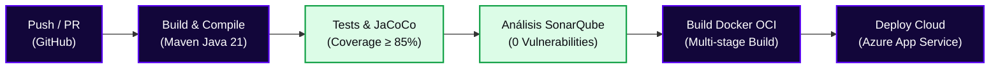

[⬅ Volver al README Principal](../../README.md)

---

## 09. CI/CD CON EL BADGE DEL PIPELINE

El ciclo de vida del software implementa integración continua y entrega continua automatizada mediante **GitHub Actions / Azure Pipelines**:

### Matriz de Pipelines por Entorno (PROD y QA)

| Pipeline | Entorno Destino | Desencadenador (Trigger) | Quality Gate Exigido | Badge de Estado |
| :--- | :--- | :--- | :--- | :---: |
| **CI - Staging / QA** | Calidad (`QA`) | Pull Request o Push a rama `develop` | Build OK + Tests Unitarios/Integración + JaCoCo ≥ 85% + SonarQube OK |  |
| **CD - Producción (PROD)** | Producción (`PROD`) | Merge a rama `main` tras validación QA | Aprobación manual + Imagen OCI desplegada en Azure App Service |  |
| **Quality Gate SonarQube** | Transversal | Ejecutado en cada build de CI | 0 Vulnerabilidades, 0 Bugs, Deuda Técnica &lt; 5% |  |

### Diagrama del Flujo Automatizado (Pipeline Stages)

### Reglas de Calidad en SonarQube (*Quality Gate Passed*)

* **Bugs:** 0
* **Vulnerabilidades:** 0
* **Hotspots de Seguridad:** 0 revisados al 100%
* **Code Smells Críticos:** 0
* **Deuda Técnica:** < 5%

  

[⬅ Volver al README Principal](../../README.md)

---