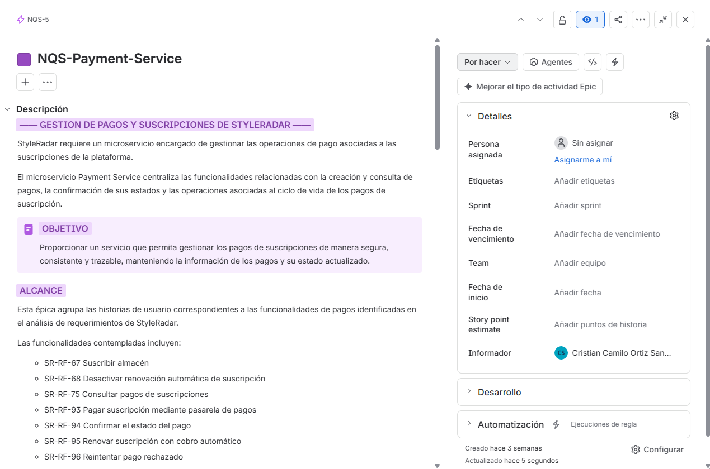

[⬅ Volver al README Principal](../../README.md)

---

## 12. EQUIPO, RESPONSABLES Y ENLACE A LA ÉPICA EN JIRA

### Equipo y Responsables del Microservicio

Desarrollado y mantenido por el **Squad NQS (`No Queremos Scrum`)** para la asignatura DOSW 2026.

  

| Rol | Nombre Completo | Usuario GitHub |
| :---: | :---: | :---: |
| **Líder del Equipo** | Cristian Camilo Ortiz Sanchez | [@CatrachoINXS](https://github.com/CatrachoINXS) |
| **Desarrollador Backend** | Juan Manuel Garzón Viracacha | [@JuanMaGV1](https://github.com/JuanMaGV1) |
| **Desarrollador Frontend** | Julian Felipe Morales Zambrano | [@JulianMorales2003](https://github.com/JulianMorales2003) |

---

### Enlaces de Gestión, Repositorios y Evidencias

El seguimiento de requerimientos, historias de usuario del Sprint y artefactos del proyecto se centraliza en los siguientes enlaces oficiales:

* **Repositorio Oficial en GitHub:** [https://github.com/StyleRadar1/NQS-Payment-Service](https://github.com/StyleRadar1/NQS-Payment-Service)
* **Organización Oficial de StyleRadar:** [https://github.com/StyleRadar1](https://github.com/StyleRadar1)
* **Épica Oficial del Microservicio (Jira):** [https://mail-team-hdkr3g6f.atlassian.net/browse/NQS-5](https://mail-team-hdkr3g6f.atlassian.net/browse/NQS-5)
* **Tablero Scrum del Squad (Jira):** [https://mail-team-hdkr3g6f.atlassian.net/jira/software/projects/NQS/boards/1?filter=&groupBy=none](https://mail-team-hdkr3g6f.atlassian.net/jira/software/projects/NQS/boards/1?filter=&groupBy=none)
* **Swagger UI Local (Puerto 8400):** [http://localhost:8400/swagger-ui.html](http://localhost:8400/swagger-ui.html)
* **Especificación OpenAPI JSON:** [http://localhost:8400/v3/api-docs](http://localhost:8400/v3/api-docs)

  
  
<b>Figura 12.1:</b> Épica oficial <code>NQS-5</code> en Atlassian Jira para <code>ms-pagos-suscripciones</code> (puerto 8400), detallando los 13 requerimientos funcionales vigentes (<code>SR-RF-67</code> al <code>SR-RF-103</code>, sin <code>SR-RF-98</code> retirado en <code>V9</code>) y el desglose de historias de usuario del Sprint.

### Requerimientos Funcionales Asignados

| Código RF | Nombre del Requerimiento | Actor Principal | Criterio de Aceptación Clave | Historia en Jira |
| :---: | :--- | :--- | :--- | :---: |
| `SR-RF-67` | Suscribir almacén aliado | Administrador de Almacén | Valida `subscriberType = STORE` y `taxId` (NIT de 9 dígitos), crea suscripción `PENDING` y retorna enlace de Mercado Pago (`202 Accepted`). | `NQS-33` |
| `SR-RF-68` | Cancelar renovación automática de almacén | Administrador de Almacén | Cancela la preaprobación en Mercado Pago manteniendo `auto_renewal = false` y acceso vigente hasta `end_date`. | `NQS-34` |
| `SR-RF-75` | Consultar pagos de suscripciones | Administrador StyleRadar | Permite listar pagos (con filtro `?status=`) y consultar detalle por ID bajo rol `STYLERADAR_ADMIN`. | `NQS-35` |
| `SR-RF-93` | Pagar suscripción mediante pasarela de pagos | Usuario / Almacén | Genera orden `PENDING` y `initPoint` en Mercado Pago evitando duplicados activos/pendientes (`409 Conflict`). | `NQS-52` |
| `SR-RF-94` | Confirmar el estado del pago | Sistema (Mercado Pago) | Valida firma HMAC `x-signature`, aplica doble idempotencia (Redis + BD) y activa la suscripción al recibir `APPROVED`. | `NQS-53` |
| `SR-RF-95` | Renovar suscripción con cobro automático | Sistema (Mercado Pago) | Procesa webhooks `subscription_authorized_payment` aprobados extendiendo `end_date` un mes adicional y publicando evento. | `NQS-54` |
| `SR-RF-96` | Reintentar pago rechazado | Usuario / Almacén | Valida titularidad y que la suscripción no esté activa, creando un nuevo intento de pago en Mercado Pago. | `NQS-55` |
| `SR-RF-97` | Consultar historial de pagos propios | Usuario / Almacén | Retorna cronológicamente las órdenes de pago asociadas al `X-User-Id` autenticado con detalle de plan y monto. | `NQS-56` |
| `SR-RF-99` | Suspender catálogo por falta de pago | Sistema (Scheduler) | El job diario (`00:10`) marca suscripciones vencidas como `SUSPENDED` y publica `styleradar.pagos.suscripcion.suspendida`. | `NQS-58` |
| `SR-RF-100` | Suscribirse a un plan de usuario (`Radar+`) | Usuario Registrado | Inicia suscripción `USER` para plan `Radar+`, valida correo electrónico y retorna enlace de pago (`202 Accepted`). | `NQS-59` |
| `SR-RF-101` | Cancelar plan de usuario | Usuario Registrado | Desactiva la renovación automática en Mercado Pago conservando los beneficios de `Radar+` hasta el fin del periodo pagado. | `NQS-60` |
| `SR-RF-102` | Consultar planes y beneficios vigentes | Usuario / Almacén | `GET /api/v1/plans` expone precios y límites (`JSONB`), y `GET /api/v1/subscriptions/{subscriberId}` informa vigencia real. | `NQS-61` |
| `SR-RF-103` | Volver al plan gratuito por falta de pago | Sistema (Scheduler) | Al suspenderse la suscripción `USER` vencida, emite `styleradar.pagos.suscripcion.plan.actualizado` con `planActual = SUSPENDED`. | `NQS-62` |

---

[⬅ Volver al README Principal](../../README.md)
